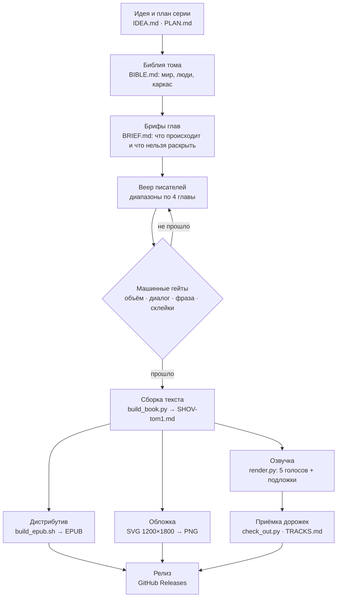

<p align="center"></p>

**RU** · [English](#english) · [← в основной README](README.md)

# Как делается том

Конвейер один на все тридцать томов: фундамент → библия → брифы → веер глав → машинные гейты → сборка → обложка → озвучка → релиз. Ниже — механика каждого шага, пороги приёмки и команды. Всё воспроизводится с нуля, ничего не делается «на глаз» там, где можно посчитать.



## Этап 0. Фундамент

Два документа, которые не меняются от главы к главе.

| Файл | Что в нём | Зачем |
|---|---|---|
| [IDEA.md](IDEA.md) | мир, механика Стыка, ставки героя, чем серия отличается от «Искажающих реальность» | чтобы все тридцать томов играли в одни правила |
| [PLAN.md](PLAN.md) | раскадровка на 30 томов: пять частей, у каждого тома своя ставка и своя локация | чтобы том 14 не пришлось придумывать после тома 13 |

Проверка на выходе: у каждого тома в плане есть **одна новая локация**, **одна ставка** и **двойной клиффхэнгер в финале**. Если у тома этого нет — он не план, а пересказ предыдущего.

## Этап 1. Библия тома

[BOOK01/BIBLE.md](BOOK01/BIBLE.md) — канон, к которому обязан прилипнуть каждый писатель:

- **Мир.** Механика Шва: протечка, метка, согласование, ранг, износ. Правило одно и то же во всех главах.
- **Люди.** Характер, речь, чего хочет, чего боится. Это же уходит в выбор голоса при озвучке.
- **Каркас 33 глав.** Одна строка на главу: что происходит, что раскрывается, где клиффхэнгер.
- **Правила письма.** Такт, тире, кавычки, где ставить системную строку, чего не делать.

Отдельно — **таблица раскрытий канона**: какая деталь впервые появляется в какой главе. Без неё поздняя глава заново «впервые находит» улику, которую герой нашёл двести тысяч знаков назад, и том начинает противоречить сам себе.

## Этап 2. Брифы глав

[BOOK01/BRIEF.md](BOOK01/BRIEF.md) — по абзацу на главу, с жёсткими рамками:

| Параметр брифа | Значение |
|---|---|
| Объём главы | 17–19 тыс. знаков с пробелами |
| Сцен | 3–6, между ними строка `* * *` |
| Доля диалога | 30–45 % строк |
| Системная строка | одна на ~4 тыс. знаков, отдельной строкой, без кавычек, после поступка |
| Клиффхэнгер | в каждой второй главе, помечено **К** |
| Запрет | нельзя раскрывать то, что по каркасу раскрывается позже |

В брифе прямо сказано: канон — в `BIBLE.md`, голос и темп — по `ch01.md`, читать оба до письма. Первая глава пишется отдельно и становится эталоном ритма для остальных.

## Этап 3. Веер писателей

Главы делятся на сплошные диапазоны по четыре и раздаются параллельно: каждому — библия, брифы своего диапазона и первая глава как образец голоса. Диапазоны не пересекаются, чтобы два писателя не правили один файл.

Правила веера:

1. **Сплошные диапазоны.** 1–4, 5–8, 9–12 и так далее. Дырка в нумерации = пропущенная глава, её потом никто не заметит.
2. **Канон передаётся таблицей.** Писатель позднего диапазона получает список того, что уже раскрыто, и не открывает это заново.
3. **Файл на главу.** `BOOK01/ch07.md`, первая строка — заголовок `# Глава седьмая. Название`. Из заголовка потом собирается оглавление, руками его никто не пишет.
4. **Никаких правок чужих глав.** Стык диапазонов правится на этапе гейтов, а не «на ходу».

## Этап 4. Машинные гейты

Приёмка главы — не «читается хорошо», а набор проверок, которые либо проходят, либо нет.

| Проверка | Порог | Чем меряется |
|---|---|---|
| Полнота | 34 файла: Введение + 33 | `ch00…ch33.md` |
| Объём главы | 16–23 тыс. знаков | `wc -m` по файлу |
| Средняя глава по тому | 16–23 тыс. | `build_book.py` |
| Доля диалога | 30–45 % строк | строки, начинающиеся с `– ` |
| Средняя фраза | 12–16 слов (в этой серии вышло 7,9 — см. README) | `build_book.py` |
| Длинное тире | 0 вхождений в тексте | `grep '—'` |
| Многоточие | только `…`, не `...` | `grep '\.\.\.'` |
| Склейки предложений | нет вида `штрек.Внизу` | регулярка на `[а-я]\.[А-Я]` |
| Дубли абзацев | 0 повторов подряд | сравнение соседних абзацев |
| Системные строки | 1 на ~4 тыс. знаков | `build_book.py` |
| Сцены | 3–6 на главу | строки `* * *` |

Склейки и дубли — самая частая болячка после скриптовых правок: массовая замена через python съедает пробел после точки или удваивает абзац-якорь. Поэтому проверка на склейки идёт **после** каждой пачки правок, а не в конце.

## Этап 5. Сборка текста и EPUB

```bash
# единый файл + метрики в консоль (объём, слова, диалог, сцены, системные строки)
python3 BOOK01/build_book.py

# читательский дистрибутив: EPUB с обложкой и оглавлением + markdown
BOOK01/build_epub.sh
```

`build_book.py` собирает главы по номерам, чистит текст (длинное тире → короткое, лишние пробелы, тройные переводы строк), клеит содержание и эпиграф, считает статистику. `build_epub.sh` отдаёт это в pandoc с метаданными и обложкой. Папка `dist/` в git не входит — EPUB живёт в релизе.

## Этап 6. Обложка

Обложка — SVG, написанный руками, а не картинка из генератора: так её можно править буквой и пересобирать в любом разрешении.

1. **Холст 1200×1800.** Соотношение 2:3, под магазины и читалки.
2. **Слои.** Фон и градиенты → геометрия (ствол шахты, клеть, тросы) → свет и трещина → текст → зерно.
3. **Текст сверху вниз.** Имя автора разреженным капсом, название, подзаголовок, «книга первая». Нижняя плашка — эпиграф и место действия.
4. **Растр.** `google-chrome --headless=new --window-size=1200,1800 --screenshot` — ImageMagick врёт про пути и шрифты, rsvg на хосте не стоит.
5. **Проверка глазами.** Кроп шапки и нижней плашки отдельными файлами: вылезание текста за поля на глаз видно за секунду, а в формулах не видно никогда.
6. **Публикация.** Коммит SVG и PNG, проверка блоб-хеша через API: `raw.githubusercontent.com` первые минуты отдаёт старую версию из кэша, и «обложка не поменялась» — это чаще всего кэш, а не ошибка.

## Этап 7. Озвучка

Пять шагов, каждый со своим кэшем — поэтому пересборка одной главы занимает минуты, а не часы.

**7.1. Подложки и эффекты** — один раз на серию.

```bash
python3 audio/gen_beds.py
```

Четыре музыкальные подложки синтезируются numpy: спокойствие, напряжение, действие, Шов (75/75/75/60 секунд, зацикливаются). Шесть эффектов: колокол системной строки, статика, удар, сквозняк, щелчок, дверь. Ни одного скачанного сэмпла — всё считается формулами, поэтому лицензий на музыку нет вообще.

**7.2. Разбор главы на блоки.** `render.py` режет текст на блоки пяти видов: `title`, `scenebreak`, `system`, `dialogue`, `narration`. Реплика — строка с `– ` в начале; системная строка — сухая справка до 130 знаков с процентами или точкой с запятой; сцена — `* * *`.

**7.3. Синтез.** Пять голосов, у каждого свой темп и высота:

| Роль | Голос | Темп | Высота |
|---|---|---|---|
| Рассказчик и Семён | `ru-RU-DmitryNeural` | −4 % | −2 Гц |
| Мужские реплики по ту сторону | `en-US-BrianMultilingualNeural` | +2 % | −4 Гц |
| Сшивка, лейтенант | `en-AU-WilliamMultilingualNeural` | +4 % | +2 Гц |
| Женские роли | `ru-RU-SvetlanaNeural` | +2 % | +2 Гц |
| Системные строки | тот же Дмитрий через кольцевую модуляцию и эхо | −12 % | −8 Гц |

Каждый блок кэшируется отдельным файлом по хешу текста и голоса. Шесть попыток на блок с коротким бэкоффом: сервис синтеза регулярно отбивает часть запросов, и без ретраев треть дорожек выходит обрезанной.

**7.4. Сведение.** Голос + подложка + эффекты: музыка дакается по огибающей голоса (до −78 % под речью), эффекты садятся на сценарные границы и системные строки, в конце громкость правится статичной поправкой по замеру EBU R128 до **−20 LUFS** (эталон 1С — −21,5; −20 — компромисс с телефоном): однопроходный `loudnorm` подтягивает каждый блок отдельно, и чтение начинает звучать ровно-механически.

**7.5. Пакетный рендер и приёмка.**

```bash
STREAMS=8 JOBS=3 ./audio/render_all.sh   # весь том: потоки по главам, метка пересбора
python3 audio/check_out.py  # длительность против объёма текста
python3 audio/tracks.py     # TRACKS.md со временем и размером
```

`render_all.sh` держит восемь потоков, каждый берёт самую младшую несобранную главу и пропускает занятые по `flock`; дорожка новее метки `out/.cast-rebuild` считается готовой, поэтому повторный запуск добирает только отставшие. `check_out.py` считает ожидаемую длительность по медианному темпу собранных дорожек (**11,3 знака в секунду**) и ругается, если файл ушёл от неё больше чем на 12 %.

## Этап 8. Публикация

1. Текст, библия, план и главы — в приватный репозиторий, ветка `main`.
2. EPUB и markdown — в релиз, чтобы читалка скачивала один файл.
3. Аудио в git не кладётся: тридцать четыре дорожки — это сотни мегабайт, историю они раздуют, а пользы в диффах ноль. Дорожки рендерятся скриптом из текста.
4. README собирается один раз и держит **проверяемые цифры**: объём, число глав, время звучания. Всё, что нельзя пересчитать, в README не попадает.

## Сводка

| Этап | Вход | Выход | Приёмка |
|---|---|---|---|
| Фундамент | идея | `IDEA.md`, `PLAN.md` | у тома есть своя ставка и локация |
| Библия | план | `BIBLE.md` | таблица раскрытий канона заполнена |
| Брифы | библия | `BRIEF.md` | у каждой главы есть рамки и клиффхэнгер |
| Веер | библия + брифы | `chNN.md` | диапазоны сплошные, файлов 34 |
| Гейты | главы | исправленные главы | таблица порогов выше |
| Сборка | главы | `SHOV-tom1.md` | метрики в коридоре серии |
| EPUB | собранный текст | `dist/*.epub` | 38 разделов, обложка на месте |
| Обложка | — | `assets/cover-tom1.{svg,png}` | текст в полях, кроп проверен глазами |
| Аудио | главы + подложки | `audio/out/*.mp3` | расхождение длительности < 12 % |
| Релиз | всё вместе | GitHub Release | README, EPUB, обложка, теги |

---

## English

One pipeline for all thirty volumes: foundation → bible → briefs → chapter fan-out → machine gates → assembly → cover → audiobook → release.

**Foundation.** `IDEA.md` fixes the world, the mechanics of the Seam and the hero's stakes; `PLAN.md` storyboards thirty volumes, each with its own location, its own stake and a double cliffhanger at the end.

**Volume bible.** `BIBLE.md` is the canon every writer must obey: world mechanics, people and their speech, the 33-chapter skeleton, the writing rules, plus a **canon reveal table** saying which detail first appears in which chapter. Without that table a late chapter "discovers" a clue the hero found two hundred thousand characters earlier.

**Briefs.** `BRIEF.md` gives one paragraph per chapter with hard limits: 17–19k characters, 3–6 scenes, 30–45 % dialogue, one system line per ~4k characters, a cliffhanger every second chapter, and an explicit list of what must not be revealed yet.

**Fan-out.** Chapters are split into contiguous ranges of four and written in parallel; each writer gets the bible, the briefs for its range and chapter one as the voice reference. Contiguous ranges only — a gap in numbering is a chapter nobody will notice is missing.

**Machine gates.** Acceptance is not "it reads well": file count, chapter length 16–23k, dialogue share, average sentence, no em dashes, `…` instead of `...`, no glued sentences like `штрек.Внизу`, no duplicated paragraphs, scene markers, system line frequency. Glued sentences and duplicated anchors are what mass script edits break first, so that check runs after every batch of edits.

**Assembly.** `python3 BOOK01/build_book.py` produces the single-file text and prints the metrics; `BOOK01/build_epub.sh` feeds the same text to pandoc with metadata and cover and writes `dist/`.

**Cover.** Hand-written SVG on a 1200×1800 canvas (2:3), layered: gradients → geometry of the mine shaft → light and the crack → typography → grain. Rasterised with headless Chrome, then the header and footer are cropped and inspected visually — overflow is obvious to the eye and invisible to a formula.

**Audiobook.** `gen_beds.py` synthesises four music beds and six sound effects with numpy — no downloaded samples, no music licensing. `render.py` parses a chapter into title / scene break / system / dialogue / narration blocks, assigns one of five voices (each with its own rate and pitch), caches every block by text hash, retries six times with a short backoff because the synthesis service drops requests, then mixes: music ducked by up to 78 % under speech, effects on scene boundaries and system lines, and applies a static EBU R128 gain to **−20 LUFS** (a one-pass `loudnorm` corrects every block separately and makes the reading sound mechanically flat). `render_all.sh` keeps eight streams, each taking the lowest unfinished chapter and skipping busy ones through `flock`; a track newer than the `out/.cast-rebuild` stamp counts as done, so a rerun only picks up the stragglers. `check_out.py` compares each track's duration against the median measured rate (11.3 characters per second) and fails on a deviation above 12 %.

**Release.** Text and planning documents in a private repo on `main`; EPUB and markdown as release assets; audio stays out of git — thirty-four tracks are hundreds of megabytes and add nothing to a diff.

`#worldbuilding #writing-pipeline #audiobook #tts #litrpg`
