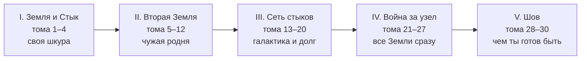

<p align="center"></p>

**RU** · [English](#english)


**Навигация:** [Идея](#идея) · [План серии](#план-серии) · [Том 1](#том-1-щепка) · [Аудио](#аудио) · [Как собрать](#как-собрать) · [English](#english)

---

## Идея

В 2019 году над Северным Уралом в небе появилась полоса — двенадцать километров длиной, полторы сотни метров шириной. Не портал и не дыра: **стык двух реальностей с разной геометрией**. Через него сочится чужая геометрия, а иногда просачиваются люди.

По ту сторону — **не чужой мир, а такая же Земля**, где Шов появился на двести двадцать лет раньше. Там уже построили орбитальные лифты, дважды воевали за узлы и почти убили себя. Сейчас у них тот же 2029 год, что и у нас.

Семён Лоскутов, мастер по ремонту лифтов из Нижнего Тагила, лезет в заброшенную шахту за котом бабушки — и проваливается через протечку. Возвращается другим человеком: с меткой **проводника**, рангом «щепка» и вопросом, на который никто не отвечает, — а что будет, когда Шов дорастёт до города.

**Чем это отличается от «Искажающих реальность»:** там контакт и игру навязывают извне, здесь герой смотрит на собственное отражение через двести лет и сам решает, стоит ли догонять тех, кто догнал и почти погиб.

## План серии



Полная раскадровка — в [PLAN.md](PLAN.md): тридцать томов, у каждого своя ставка, новая локация каждые 5–8 глав и двойной клиффхэнгер в финале.

| Часть | Тома | Ставка |
|---|---|---|
| I. Земля и Стык | 1–4 | своя шкура, работа, дочь |
| II. Вторая Земля | 5–12 | чужая война и собственная личность |
| III. Сеть стыков | 13–20 | галактика, долг, ремесло |
| IV. Война за узел | 21–27 | существование всех Земель |
| V. Финал | 28–30 | чем ты готов быть, чтобы шов держался |

## Том 1 «Щепка»

<!-- stats -->

| Параметр | Том 1 | Норма серии |
|---|---|---|
| Объём | **609 200 знаков** (15,2 а.л.) | 588–624 тыс. |
| Глав | 33 + Введение | 26–37 |
| Средняя глава | 18,1 тыс. знаков | 16–23 тыс. |
| Слов | 101 761 | — |
| Сцен | 166 (5 на главу) | 3–6 на главу |
| Системных строк | 17 | ~1 на 3,8 тыс. |
| Диалог | 50 % строк | 30–38 % |
| Средняя фраза | 7,9 слова | 12–16 |

Где книга **вылезает из нормы** — честно:

- диалога больше (50 % против 30–38 %): сцены держатся на разговоре, потому что герой — рассказчик;
- средняя фраза короче (7,9 против 12–16 слов): сказывается такт «абзац-разбор → удар одной строкой»;
- системных строк меньше (17 против ~160): в этом мире нет игровой системы, справку выдаёт Стык, и выдают её только на поступок.

Остальное в коридоре: объём, число глав, размер главы, сцены, клиффхэнгеры через главу и двойной в финале, одна глава от чужого POV (глава 18, лейтенант Сшивки), земной якорь в каждой главе.

Правила, по которым собрана книга, — [BOOK01/BIBLE.md](BOOK01/BIBLE.md): имена, механика согласования, каркас из 33 глав. Брифы глав — [BOOK01/BRIEF.md](BOOK01/BRIEF.md).

## Аудио

Озвучка в духе записей 1С-Паблишинг: рассказчик, отдельные голоса на персонажей, музыкальная подложка с дакингом, эффекты на сценарные границы и системные строки.

| Слой | Как сделано |
|---|---|
| Голоса | нейронный синтез, пять тембров: рассказчик, два мужских, женский, «железный» для системных строк |
| Музыка | четыре подложки (спокойствие, напряжение, действие, Шов) синтезируются numpy |
| Эффекты | колокол системной строки, статика, удар, сквозняк, скрип клети, щелчок |
| Сведение | дакинг музыки по огибающей голоса, мягкий лимитер, `loudnorm` −16 LUFS |

Подробности и все команды — [audio/README.md](audio/README.md).

## Как собрать

```bash
# текст: все главы в один файл + метрики
python3 BOOK01/build_book.py

# аудио: подложки и эффекты (один раз)
python3 audio/gen_beds.py

# аудио: глава или вся книга (кэш синтеза переиспользуется)
python3 audio/render.py BOOK01/ch01.md
./audio/render_book.sh
```

## Структура

```
shov/
├── assets/banner.svg     обложка-баннер
├── IDEA.md               идея серии: мир, механика, ставки
├── PLAN.md               план на 30 томов
├── BOOK01/
│   ├── BIBLE.md          библия тома: люди, правила, каркас
│   ├── BRIEF.md          брифы глав 2–33
│   ├── ch00…ch33.md      главы
│   ├── SHOV-tom1.md      собранный текст
│   └── build_book.py     сборка и статистика
└── audio/
    ├── gen_beds.py       подложки и эффекты
    ├── render.py         озвучка и сведение
    ├── render_book.sh    пакетный рендер
    └── out/              готовые mp3 по главам
```

## English

**The Seam** — a 30-volume series written in the voice of Mikhail Atamanov's *Distorting Reality* cycle, with a new world and new people.

In 2019 a twelve-kilometre strip appeared in the sky over the Northern Urals. It is not a portal but a **seam between two realities with different geometry**. On the other side lies the same Earth — where the seam opened two hundred and twenty years earlier, where orbital elevators exist and two wars were fought over the nodes, and where the same 2029 has already gone catastrophically wrong.

Semyon Loskutov, a lift repairman from Nizhny Tagil, climbs into an abandoned mine to fetch his grandmother's cat and falls through the leak. He comes back marked as a **conductor**: the lowest rank, one crossing a day, and a question nobody answers — what happens when the seam reaches the city.

| Part | Volumes | Stakes |
|---|---|---|
| I. Earth and the Bureau | 1–4 | his own skin, his job, his daughter |
| II. Second Earth | 5–12 | someone else's war, his own identity |
| III. The Network | 13–20 | the galaxy, debts, the craft |
| IV. War for the Node | 21–27 | every Earth at once |
| V. The Seam | 28–30 | what you are willing to become |

Volume 1, *Splinter*, is complete with its full text; the audiobook is produced with five synthetic voices, four generated music beds, sound effects, ducking and −16 LUFS loudness normalisation. Everything is reproducible from the scripts in `audio/`.

`#audiobook #litrpg #popadantsy #series-plan #russian-prose`

---

Подготовлено в рабочем пространстве DSH «My books»; голос серии снят с тринадцати томов «Искажающих реальность» — стилевой паспорт остаётся в рабочем пространстве DSH, в репозиторий не входит.
