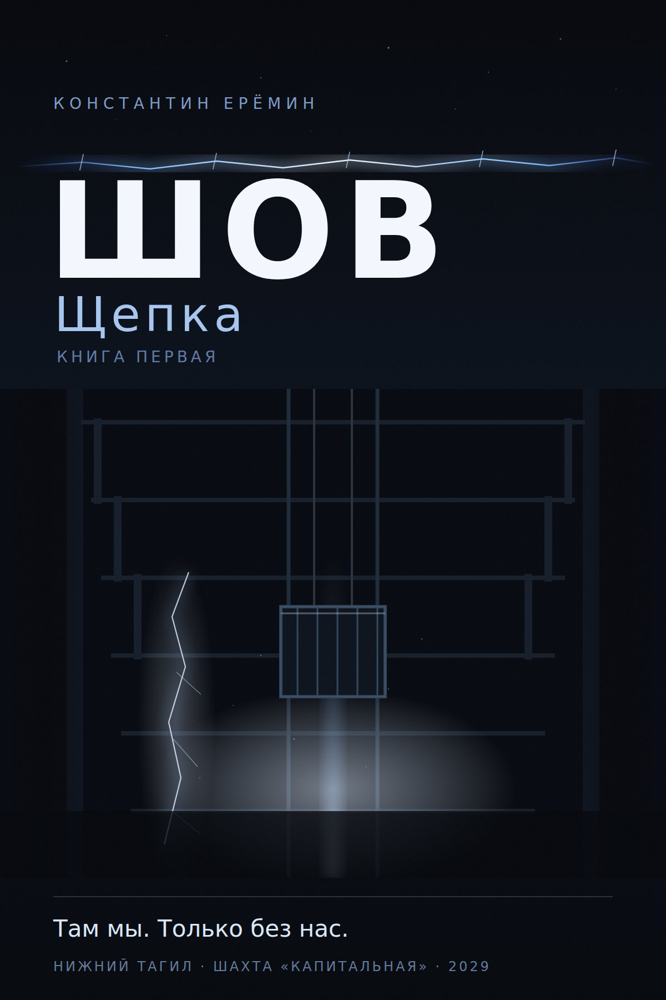
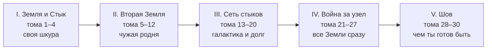
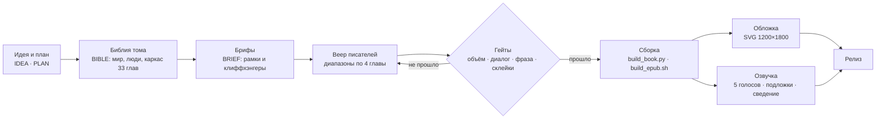

<p align="center"></p>

<p align="center"></p>

<h1 align="center">Шов</h1>
<p align="center"><b>Книга первая. Щепка</b> · Константин Ерёмин</p>

<p align="center">
  <b>RU</b> · <a href="#english">English</a>
</p>

<p align="center">
  
  
  
  
  
  
</p>

**Разделы:** [⬇ Скачать](https://github.com/rukazax/shov/releases/tag/v1.0) · [О книге](#о-книге) · [Как устроен мир](#как-устроен-мир) · [План серии](#план-серии) · [Том первый](#том-первый-щепка) · [Оглавление](#оглавление) · [Аудио](#аудио) · [Как делается том](#как-делается-том) · [Сборка](#сборка) · [Структура](#структура) · [English](#english)

---

## О книге

<p align="center"><a href="https://github.com/rukazax/shov/releases/tag/v1.0"><b>⬇ Скачать том 1 «Щепка»</b></a><br>EPUB · единый markdown · обложка · аудиоархив 627 МБ · пример озвучки</p>

Двенадцатого августа 2019 года над Северным Уралом в небе появилась полоса: двенадцать километров длиной, сто пятьдесят метров шириной. Не портал, не дыра и не разлом — **стык двух реальностей с разной геометрией**. Через него сочится чужая геометрия, а иногда просачиваются люди.

По ту сторону — не чужой мир, а такая же Земля. Только Шов открылся там на двести двадцать лет раньше: успели построить орбитальные лифты, дважды воевали за узлы и почти убили себя. Сейчас у них тот же 2029 год, что и у нас, и они очень хотят знать, где мы были эти двести лет.

Семён Лоскутов, мастер по ремонту лифтов из Нижнего Тагила, лезет в заброшенную шахту за котом бабушки — и проваливается через протечку. Возвращается другим человеком: с меткой **проводника**, рангом «щепка», правом на одно согласование в день и вопросом, на который никто не отвечает. Что будет, когда Шов дорастёт до города?

Книга написана в стилистике Михаила Атаманова, серия «Искажающие реальность». Это **не** произведение автора: мир, имена и сюжет новые. Голос серии снят с тринадцати томов — стилевой паспорт остался в рабочем пространстве и в репозиторий не входит.

Главное отличие от «Искажающих реальность»: там контакт и игру навязывают извне, а здесь герой смотрит на собственное отражение через двести лет и сам решает, стоит ли догонять тех, кто догнал и почти погиб.

## Как устроен мир

| Понятие | Что это на деле |
|---|---|
| **Шов** | стык геометрий; растёт, пока его не согласуют, и дорастает до города за несколько месяцев |
| **Протечка** | место, где Шов тонкий: сорок метров вниз — и ты уже на той стороне |
| **Метка** | печать Стыка на человеке: пропускает через протечку, но отмечает как чужого для обеих сторон |
| **Согласование** | ремесло проводника: совместить две геометрии так, чтобы обе уцелели. Ошибка видна линейкой |
| **Щепка** | низший ранг проводника: одно согласование в день, износ мизерный, но и допуск — на порог |
| **Стык** | организация на той стороне, которая ставит метки. Ведомости не врут, но и не всё показывают |

Правила механики, имена и каркас глав — [BOOK01/BIBLE.md](BOOK01/BIBLE.md). Брифы глав — [BOOK01/BRIEF.md](BOOK01/BRIEF.md).

## План серии



| Часть | Тома | Ставка |
|---|---|---|
| I. Земля и Стык | 1–4 | своя шкура, работа, дочь |
| II. Вторая Земля | 5–12 | чужая война и собственная личность |
| III. Сеть стыков | 13–20 | галактика, долг, ремесло |
| IV. Война за узел | 21–27 | существование всех Земель |
| V. Финал | 28–30 | чем ты готов быть, чтобы шов держался |

Раскадровка на тридцать томов — [PLAN.md](PLAN.md). Идея мира и правила — [IDEA.md](IDEA.md).

## Том первый «Щепка»

| Параметр | Том 1 | Норма серии |
|---|---|---|
| Объём | **608 881 знак** (15,2 а.л.) | 588–624 тыс. |
| Без пробелов | 492 400 знаков | — |
| Глав | 33 + Введение | 26–37 |
| Средняя глава | 18,2 тыс. знаков | 16–23 тыс. |
| Слов | 101 695 | — |
| Сцен | 166 (5 на главу) | 3–6 на главу |
| Системных строк | 28 | ~1 на 3,8 тыс. знаков |
| Диалог | 50 % строк | 30–38 % |
| Средняя фраза | 7,9 слова | 12–16 |

Где книга вылезает из нормы — честно:

- **диалога больше** (50 % против 30–38 %): сцены держатся на разговоре, потому что рассказчик — сам герой и он всё время оценивает услышанное;
- **средняя фраза короче** (7,9 против 12–16 слов): сказывается такт «абзац-разбор → удар одной строкой», без этого голос серии не звучит;
- **системных строк меньше** (28 против ~160): в этом мире нет игровой системы. Справку выдаёт Стык, и только за поступок, а не за каждый шаг.

Всё остальное в коридоре: объём, число глав, размер главы, сцены, клиффхэнгер через главу, двойной в финале, одна глава от чужого POV (глава восемнадцатая, лейтенант Сшивки) и одна земная привязка в каждой главе.

### Оглавление

<details open>
<summary>34 файла, 608 881 знак</summary>

| # | Глава | Объём |
|---|---|---|
| 1 | Введение. Одиннадцать миллиметров | 8 тыс. |
| 2 | Глава первая. Ведомость на два лифта | 14 тыс. |
| 3 | Глава вторая. Кот не дурак | 18 тыс. |
| 4 | Глава третья. Сорок метров вниз | 17 тыс. |
| 5 | Глава четвёртая. Не наш Тагил | 18 тыс. |
| 6 | Глава пятая. Хлеб без соли | 17 тыс. |
| 7 | Глава шестая. Три дня и шесть часов | 18 тыс. |
| 8 | Глава седьмая. Метка | 18 тыс. |
| 9 | Глава восьмая. Согласование: четыре и две | 18 тыс. |
| 10 | Глава девятая. Разговор у бабушки | 18 тыс. |
| 11 | Глава десятая. Контракт с приложением | 18 тыс. |
| 12 | Глава одиннадцатая. Нулевой километр | 17 тыс. |
| 13 | Глава двенадцатая. Ходьба с закрытыми глазами | 17 тыс. |
| 14 | Глава тринадцатая. Первый образец | 18 тыс. |
| 15 | Глава четырнадцатая. Одиннадцать миллиметров | 18 тыс. |
| 16 | Глава пятнадцатая. Боцман | 18 тыс. |
| 17 | Глава шестнадцатая. Тонкое место | 18 тыс. |
| 18 | Глава семнадцатая. Погоня на той стороне | 18 тыс. |
| 19 | Глава восемнадцатая. Лейтенант | 18 тыс. |
| 20 | Глава девятнадцатая. Ведомости не врут | 18 тыс. |
| 21 | Глава двадцатая. Мухин | 18 тыс. |
| 22 | Глава двадцать первая. Караван из трёх | 17 тыс. |
| 23 | Глава двадцать вторая. Компас | 18 тыс. |
| 24 | Глава двадцать третья. Домой | 17 тыс. |
| 25 | Глава двадцать четвёртая. Даша спрашивает | 18 тыс. |
| 26 | Глава двадцать пятая. Чужая подпись | 17 тыс. |
| 27 | Глава двадцать шестая. Крыша | 18 тыс. |
| 28 | Глава двадцать седьмая. Обратный ход | 18 тыс. |
| 29 | Глава двадцать восьмая. Своими ногами | 18 тыс. |
| 30 | Глава двадцать девятая. Стык закрывает двери | 17 тыс. |
| 31 | Глава тридцатая. Кто здесь был | 18 тыс. |
| 32 | Глава тридцать первая. Не ты | 18 тыс. |
| 33 | Глава тридцать вторая. Щепка, которая держит | 17 тыс. |
| 34 | Глава тридцать третья. Тише едешь | 17 тыс. |

</details>

Читать целиком: [BOOK01/SHOV-tom1.md](BOOK01/SHOV-tom1.md) — единый файл с содержанием и эпиграфом. EPUB для читалки — в [релизе](https://github.com/rukazax/shov/releases).

## Аудио

Озвучка в духе записей 1С-Паблишинг: рассказчик, отдельные голоса на персонажей, музыкальная подложка с дакингом, эффекты на сценарные границы и системные строки.

> **Как доводили звучание:** образцы новых голосов (минута, все тембры), замеры по эталонам 1С и отвергнутые движки — [audio/VOICES.md](audio/VOICES.md).

| Слой | Как сделано |
|---|---|
| Голоса | нейронный синтез, пять тембров: рассказчик, два мужских, женский, «железный» для системных строк |
| Музыка | четыре подложки (спокойствие, напряжение, действие, Шов) синтезируются numpy |
| Эффекты | колокол системной строки, статика, удар, сквозняк, скрип клети, щелчок |
| Сведение | дакинг музыки по огибающей голоса, мягкий лимитер, `loudnorm` −16 LUFS |

| Роль | Голос |
|---|---|
| Рассказчик и Семён | `ru-RU-DmitryNeural` |
| Мужские реплики по ту сторону | `en-US-BrianMultilingualNeural` |
| Сшивка, лейтенант | `en-AU-WilliamMultilingualNeural` |
| Женские роли (бабушка, Даша) | `ru-RU-SvetlanaNeural` |
| Системные строки Согласования | тот же рассказчик через кольцевую модуляцию и эхо — «железный» голос |

**34 дорожки, 15 ч 12 мин звучания, 657 МБ.** Каждая глава — отдельный mp3, 96 кбит/с моно, приведённый к −16 LUFS. В git аудио не входит: дорожки собираются скриптами из текста, кэш синтеза переиспользуется между запусками.

<details>
<summary>Дорожки по главам</summary>

| # | Дорожка | Время |
|---|---|---|
| 1 | Введение. Одиннадцать миллиметров | 11 мин |
| 2 | Глава первая. Ведомость на два лифта | 22 мин |
| 3 | Глава вторая. Кот не дурак | 28 мин |
| 4 | Глава третья. Сорок метров вниз | 28 мин |
| 5 | Глава четвёртая. Не наш Тагил | 29 мин |
| 6 | Глава пятая. Хлеб без соли | 28 мин |
| 7 | Глава шестая. Три дня и шесть часов | 27 мин |
| 8 | Глава седьмая. Метка | 25 мин |
| 9 | Глава восьмая. Согласование: четыре и две | 25 мин |
| 10 | Глава девятая. Разговор у бабушки | 27 мин |
| 11 | Глава десятая. Контракт с приложением | 26 мин |
| 12 | Глава одиннадцатая. Нулевой километр | 25 мин |
| 13 | Глава двенадцатая. Ходьба с закрытыми глазами | 26 мин |
| 14 | Глава тринадцатая. Первый образец | 29 мин |
| 15 | Глава четырнадцатая. Одиннадцать миллиметров | 28 мин |
| 16 | Глава пятнадцатая. Боцман | 27 мин |
| 17 | Глава шестнадцатая. Тонкое место | 28 мин |
| 18 | Глава семнадцатая. Погоня на той стороне | 28 мин |
| 19 | Глава восемнадцатая. Лейтенант | 25 мин |
| 20 | Глава девятнадцатая. Ведомости не врут | 27 мин |
| 21 | Глава двадцатая. Мухин | 27 мин |
| 22 | Глава двадцать первая. Караван из трёх | 26 мин |
| 23 | Глава двадцать вторая. Компас | 26 мин |
| 24 | Глава двадцать третья. Домой | 26 мин |
| 25 | Глава двадцать четвёртая. Даша спрашивает | 28 мин |
| 26 | Глава двадцать пятая. Чужая подпись | 26 мин |
| 27 | Глава двадцать шестая. Крыша | 28 мин |
| 28 | Глава двадцать седьмая. Обратный ход | 28 мин |
| 29 | Глава двадцать восьмая. Своими ногами | 29 мин |
| 30 | Глава двадцать девятая. Стык закрывает двери | 25 мин |
| 31 | Глава тридцатая. Кто здесь был | 27 мин |
| 32 | Глава тридцать первая. Не ты | 28 мин |
| 33 | Глава тридцать вторая. Щепка, которая держит | 27 мин |
| 34 | Глава тридцать третья. Тише едешь | 27 мин |

</details>

Подробности конвейера и все команды — [audio/README.md](audio/README.md). Список дорожек с временем — [audio/TRACKS.md](audio/TRACKS.md).

## Как делается том

Том не пишется «за один заход»: сначала фундамент и канон, потом брифы, потом главы веером, потом машинные гейты, только потом обложка и озвучка.



| Этап | Что делается | Чем проверяется |
|---|---|---|
| Фундамент | идея мира и раскадровка на 30 томов | у тома есть своя ставка, локация и двойной финал |
| Библия | канон: механика, люди, каркас 33 глав, таблица раскрытий | поздняя глава не «впервые находит» старое |
| Брифы | по абзацу на главу: 17–19 тыс. знаков, 3–6 сцен, клиффхэнгер через главу | рамки записаны до письма, а не после |
| Веер | главы диапазонами по 4 пишутся параллельно | диапазоны сплошные, файлов 34 |
| Гейты | объём, диалог, средняя фраза, тире, `…`, склейки, дубли | таблица порогов, а не «читается хорошо» |
| Сборка | единый текст и EPUB с обложкой | метрики в коридоре серии |
| Обложка | SVG руками, растр headless Chrome | кроп шапки и плашки смотрим глазами |
| Озвучка | 5 голосов, 4 подложки, 6 эффектов, сведение −16 LUFS | длительность против 12 знаков в секунду |

Подробная механика каждого шага, пороги и команды — [PRODUCTION.md](PRODUCTION.md).

## Сборка

```bash
git clone https://github.com/rukazax/shov.git
cd shov

# текст: все главы в один файл + метрики в консоль
python3 BOOK01/build_book.py

# читательский дистрибутив: EPUB и единый markdown в dist/
BOOK01/build_epub.sh

# аудио: подложки и эффекты (один раз, ~2 минуты)
python3 audio/gen_beds.py

# аудио: одна глава или вся книга — кэш синтеза переиспользуется
python3 audio/render.py BOOK01/ch01.md
./audio/render_book.sh          # все главы, добивает недостающие
```

Проверка готовности озвучки: `python3 audio/check_out.py` — длительности, тишина по краям, громкость, битрейт.

## Структура

```
shov/
├── assets/
│   ├── banner.svg          баннер серии
│   └── cover-tom1.png      обложка тома 1 (и .svg-исходник)
├── BOOK01/
│   ├── BIBLE.md            библия тома: люди, правила, каркас
│   ├── BRIEF.md            брифы глав 2–33
│   ├── ch00…ch33.md        главы
│   ├── SHOV-tom1.md        собранный текст
│   ├── build_book.py       сборка и статистика
│   └── build_epub.sh       EPUB для читалки
├── audio/
│   ├── gen_beds.py         подложки и эффекты
│   ├── render.py           озвучка и сведение
│   ├── render_book.sh      пакетный рендер
│   ├── check_out.py        приёмка готовых дорожек
│   └── out/                mp3 по главам (в git не входят)
├── IDEA.md                 идея серии: мир, механика, ставки
├── PRODUCTION.md           конвейер тома: этапы, пороги, команды
├── PLAN.md                 план на 30 томов
└── dist/                   EPUB и markdown для читателей (в git не входят)
```

## Права

Текст — © Константин Ерёмин. Скрипты сборки, озвучки и генерации подложек — MIT, берите и пользуйтесь. Голос серии снят с книг Михаила Атаманова как стилевой ориентир; ни одна строка из «Искажающих реальность» здесь не воспроизведена.

## English

<p align="center"><a href="https://github.com/rukazax/shov/releases/tag/v1.0"><b>⬇ Download volume one</b></a><br>EPUB · single-file markdown · cover artwork · 627 MB audiobook archive · audio sample</p>

**The Seam** — a thirty-volume series written in the voice of Mikhail Atamanov's *Distorting Reality* cycle, with a new world, new people and a new plot. Not a work by that author; the style profile was derived from thirteen volumes and stays out of this repository.

On 12 August 2019 a strip appeared in the sky over the Northern Urals: twelve kilometres long, a hundred and fifty metres wide. Not a portal, not a hole — a **seam between two realities with different geometry**. Alien geometry bleeds through it, and now and then people do too.

Beyond it lies the same Earth, where the seam opened two hundred and twenty years earlier. They built orbital elevators, fought two wars over the nodes and nearly killed themselves. Their 2029 is our 2029, and they would very much like to know where we have been for two centuries.

Semyon Loskutov, a lift repairman from Nizhny Tagil, climbs into an abandoned mine to fetch his grandmother's cat and falls through a leak. He comes back marked as a **conductor**: the lowest rank, one alignment a day, and a question nobody answers — what happens when the seam reaches the city.

| Volume 1 | Value |
|---|---|
| Title | *Splinter* (Щепка) |
| Chapters | 33 + Introduction |
| Length | 608 881 characters, 101 695 words |
| Scenes | 166 |
| Audiobook | 34 tracks, five synthetic voices |
| Formats | Markdown in repo, EPUB in Releases |

The full text is in Russian only: [BOOK01/SHOV-tom1.md](BOOK01/SHOV-tom1.md). Series plan, world rules and the style bible are in [PLAN.md](PLAN.md), [IDEA.md](IDEA.md) and [BOOK01/BIBLE.md](BOOK01/BIBLE.md) — also Russian.

The production pipeline — foundation, bible, briefs, fan-out, machine gates, assembly, cover, audiobook — is documented step by step in [PRODUCTION.md](PRODUCTION.md).

Everything is reproducible: `python3 BOOK01/build_book.py` assembles the book, `BOOK01/build_epub.sh` produces the EPUB, `./audio/render_book.sh` renders the audiobook chapter by chapter with caching.

`#audiobook #litrpg #series-plan #russian-prose #worldbuilding #tts`
