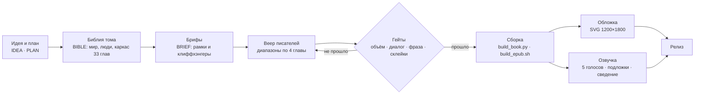

<p align="center"></p>

<p align="center"></p>

<h1 align="center">Шов</h1>
<p align="center"><b>Книга первая. Щепка</b> · Константин Ерёмин</p>

<p align="center">
  <b>RU</b> · <a href="#english">English</a>
</p>

<p align="center">
  
  
  
  
  
  
</p>

**Разделы:** [⬇ Скачать](https://github.com/rukazax/shov/releases/tag/v1.0) · [🎧 Аудио-релиз](https://github.com/rukazax/shov/releases/tag/v1.1) · [О книге](#о-книге) · [Как устроен мир](#как-устроен-мир) · [План серии](#план-серии) · [Том первый](#том-первый-щепка) · [Оглавление](#оглавление) · [Аудио](#аудио) · [Как делается том](#как-делается-том) · [Сборка](#сборка) · [Структура](#структура) · [English](#english)

---

## О книге

<p align="center"><a href="https://github.com/rukazax/shov/releases/tag/v1.0"><b>⬇ Скачать том 1 «Щепка»</b></a> · <a href="https://github.com/rukazax/shov/releases/tag/v1.1"><b>🎧 Аудио: 34 дорожки, 14 ч 57 мин</b></a><br>EPUB · единый markdown · обложка · аудио отдельными файлами в релизе v1.1</p>

Двенадцатого августа 2019 года над Северным Уралом в небе появилась полоса: двенадцать километров длиной, сто пятьдесят метров шириной. Не портал, не дыра и не разлом — **стык двух реальностей с разной геометрией**. Через него сочится чужая геометрия, а иногда просачиваются люди.

По ту сторону — не чужой мир, а такая же Земля. Только Шов открылся там на двести двадцать лет раньше: успели построить орбитальные лифты, дважды воевали за узлы и почти убили себя. Сейчас у них тот же 2029 год, что и у нас, и они очень хотят знать, где мы были эти двести лет.

Семён Лоскутов, мастер по ремонту лифтов из Нижнего Тагила, лезет в заброшенную шахту за котом бабушки — и проваливается через протечку. Возвращается другим человеком: с меткой **проводника**, рангом «щепка», правом на одно согласование в день и вопросом, на который никто не отвечает. Что будет, когда Шов дорастёт до города?

Книга написана в стилистике Михаила Атаманова, серия «Искажающие реальность». Это **не** произведение автора: мир, имена и сюжет новые. Голос серии снят с тринадцати томов — стилевой паспорт остался в рабочем пространстве и в репозиторий не входит.

Главное отличие от «Искажающих реальность»: там контакт и игру навязывают извне, а здесь герой смотрит на собственное отражение через двести лет и сам решает, стоит ли догонять тех, кто догнал и почти погиб.

## Как устроен мир

| Понятие | Что это на деле |
|---|---|
| **Шов** | стык геометрий; растёт, пока его не согласуют, и дорастает до города за несколько месяцев |
| **Протечка** | место, где Шов тонкий: сорок метров вниз — и ты уже на той стороне |
| **Метка** | печать Стыка на человеке: пропускает через протечку, но отмечает как чужого для обеих сторон |
| **Согласование** | ремесло проводника: совместить две геометрии так, чтобы обе уцелели. Ошибка видна линейкой |
| **Щепка** | низший ранг проводника: одно согласование в день, износ мизерный, но и допуск — на порог |
| **Стык** | организация на той стороне, которая ставит метки. Ведомости не врут, но и не всё показывают |

Правила механики, имена и каркас глав — [BOOK01/BIBLE.md](BOOK01/BIBLE.md). Брифы глав — [BOOK01/BRIEF.md](BOOK01/BRIEF.md).

## План серии


| Часть | Тома | Ставка |
|---|---|---|
| I. Земля и Стык | 1–4 | своя шкура, работа, дочь |
| II. Вторая Земля | 5–12 | чужая война и собственная личность |
| III. Сеть стыков | 13–20 | галактика, долг, ремесло |
| IV. Война за узел | 21–27 | существование всех Земель |
| V. Финал | 28–30 | чем ты готов быть, чтобы шов держался |

Раскадровка на тридцать томов — [PLAN.md](PLAN.md). Идея мира и правила — [IDEA.md](IDEA.md).

## Том первый «Щепка»

| Параметр | Том 1 | Норма серии |
|---|---|---|
| Объём | **608 881 знак** (15,2 а.л.) | 588–624 тыс. |
| Без пробелов | 492 400 знаков | — |
| Глав | 33 + Введение | 26–37 |
| Средняя глава | 18,2 тыс. знаков | 16–23 тыс. |
| Слов | 101 695 | — |
| Сцен | 166 (5 на главу) | 3–6 на главу |
| Системных строк | 28 | ~1 на 3,8 тыс. знаков |
| Диалог | 50 % строк | 30–38 % |
| Средняя фраза | 7,9 слова | 12–16 |

Где книга вылезает из нормы — честно:

- **диалога больше** (50 % против 30–38 %): сцены держатся на разговоре, потому что рассказчик — сам герой и он всё время оценивает услышанное;
- **средняя фраза короче** (7,9 против 12–16 слов): сказывается такт «абзац-разбор → удар одной строкой», без этого голос серии не звучит;
- **системных строк меньше** (28 против ~160): в этом мире нет игровой системы. Справку выдаёт Стык, и только за поступок, а не за каждый шаг.

Всё остальное в коридоре: объём, число глав, размер главы, сцены, клиффхэнгер через главу, двойной в финале, одна глава от чужого POV (глава восемнадцатая, лейтенант Сшивки) и одна земная привязка в каждой главе.

### Оглавление

<details open>
<summary>34 файла, 608 881 знак</summary>

| # | Глава | Объём |
|---|---|---|
| 1 | Введение. Одиннадцать миллиметров | 8 тыс. |
| 2 | Глава первая. Ведомость на два лифта | 14 тыс. |
| 3 | Глава вторая. Кот не дурак | 18 тыс. |
| 4 | Глава третья. Сорок метров вниз | 17 тыс. |
| 5 | Глава четвёртая. Не наш Тагил | 18 тыс. |
| 6 | Глава пятая. Хлеб без соли | 17 тыс. |
| 7 | Глава шестая. Три дня и шесть часов | 18 тыс. |
| 8 | Глава седьмая. Метка | 18 тыс. |
| 9 | Глава восьмая. Согласование: четыре и две | 18 тыс. |
| 10 | Глава девятая. Разговор у бабушки | 18 тыс. |
| 11 | Глава десятая. Контракт с приложением | 18 тыс. |
| 12 | Глава одиннадцатая. Нулевой километр | 17 тыс. |
| 13 | Глава двенадцатая. Ходьба с закрытыми глазами | 17 тыс. |
| 14 | Глава тринадцатая. Первый образец | 18 тыс. |
| 15 | Глава четырнадцатая. Одиннадцать миллиметров | 18 тыс. |
| 16 | Глава пятнадцатая. Боцман | 18 тыс. |
| 17 | Глава шестнадцатая. Тонкое место | 18 тыс. |
| 18 | Глава семнадцатая. Погоня на той стороне | 18 тыс. |
| 19 | Глава восемнадцатая. Лейтенант | 18 тыс. |
| 20 | Глава девятнадцатая. Ведомости не врут | 18 тыс. |
| 21 | Глава двадцатая. Мухин | 18 тыс. |
| 22 | Глава двадцать первая. Караван из трёх | 17 тыс. |
| 23 | Глава двадцать вторая. Компас | 18 тыс. |
| 24 | Глава двадцать третья. Домой | 17 тыс. |
| 25 | Глава двадцать четвёртая. Даша спрашивает | 18 тыс. |
| 26 | Глава двадцать пятая. Чужая подпись | 17 тыс. |
| 27 | Глава двадцать шестая. Крыша | 18 тыс. |
| 28 | Глава двадцать седьмая. Обратный ход | 18 тыс. |
| 29 | Глава двадцать восьмая. Своими ногами | 18 тыс. |
| 30 | Глава двадцать девятая. Стык закрывает двери | 17 тыс. |
| 31 | Глава тридцатая. Кто здесь был | 18 тыс. |
| 32 | Глава тридцать первая. Не ты | 18 тыс. |
| 33 | Глава тридцать вторая. Щепка, которая держит | 17 тыс. |
| 34 | Глава тридцать третья. Тише едешь | 17 тыс. |

</details>

Читать целиком: [BOOK01/SHOV-tom1.md](BOOK01/SHOV-tom1.md) — единый файл с содержанием и эпиграфом. EPUB для читалки — в [релизе](https://github.com/rukazax/shov/releases).

## Аудио

Озвучка в духе записей 1С-Паблишинг: рассказчик, отдельные голоса на персонажей, музыкальная подложка с дакингом, эффекты на сценарные границы и системные строки.

> **Слушать:** [релиз v1.1 — 34 дорожки, 14 ч 57 мин, 616 МБ](https://github.com/rukazax/shov/releases/tag/v1.1). Каждая глава — отдельный mp3, ссылки в таблице ниже. Прежний каст лежит архивом в [v1.0](https://github.com/rukazax/shov/releases/tag/v1.0) и больше не актуален.
>
> **Как доводили звучание:** образцы новых голосов (минута, все тембры), замеры по эталонам 1С и отвергнутые движки — [audio/VOICES.md](audio/VOICES.md).

| Слой | Как сделано |
|---|---|
| Голоса | нейронный синтез, пять тембров: рассказчик, два мужских, женский, «железный» для системных строк |
| Музыка | четыре подложки (спокойствие, напряжение, действие, Шов) синтезируются numpy |
| Эффекты | колокол системной строки, статика, удар, сквозняк, скрип клети, щелчок |
| Сведение | дакинг музыки по огибающей голоса, мягкий лимитер, `loudnorm` −20 LUFS |

| Роль | Голос |
|---|---|
| Рассказчик и Семён | `ru-RU-DmitryNeural` |
| Мужские реплики по ту сторону | `en-US-BrianMultilingualNeural` |
| Сшивка, лейтенант | `en-AU-WilliamMultilingualNeural` |
| Женские роли (бабушка, Даша) | `ru-RU-SvetlanaNeural` |
| Системные строки Согласования | тот же рассказчик через кольцевую модуляцию и эхо — «железный» голос |

**34 дорожки, 14 ч 57 мин звучания, 616 МБ.** Каждая глава — отдельный mp3, 96 кбит/с моно, приведённый к −20 LUFS; разброс громкости по тому — от −20,5 до −20,4 LUFS. В git аудио не входит: дорожки собираются скриптами из текста, кэш синтеза переиспользуется между запусками.

<details>
<summary>Дорожки по главам — ссылки на файлы</summary>

| # | Дорожка | Время |
|---|---|---|
| 1 | [Введение. Одиннадцать миллиметров](https://github.com/rukazax/shov/releases/download/v1.1/shov-ch00-vvedenie.mp3) | 11:07 |
| 2 | [Глава первая. Ведомость на два лифта](https://github.com/rukazax/shov/releases/download/v1.1/shov-ch01.mp3) | 21:42 |
| 3 | [Глава вторая. Кот не дурак](https://github.com/rukazax/shov/releases/download/v1.1/shov-ch02.mp3) | 27:30 |
| 4 | [Глава третья. Сорок метров вниз](https://github.com/rukazax/shov/releases/download/v1.1/shov-ch03.mp3) | 27:16 |
| 5 | [Глава четвёртая. Не наш Тагил](https://github.com/rukazax/shov/releases/download/v1.1/shov-ch04.mp3) | 29:27 |
| 6 | [Глава пятая. Хлеб без соли](https://github.com/rukazax/shov/releases/download/v1.1/shov-ch05.mp3) | 28:07 |
| 7 | [Глава шестая. Три дня и шесть часов](https://github.com/rukazax/shov/releases/download/v1.1/shov-ch06.mp3) | 26:05 |
| 8 | [Глава седьмая. Метка](https://github.com/rukazax/shov/releases/download/v1.1/shov-ch07.mp3) | 24:13 |
| 9 | [Глава восьмая. Согласование: четыре и две](https://github.com/rukazax/shov/releases/download/v1.1/shov-ch08.mp3) | 24:49 |
| 10 | [Глава девятая. Разговор у бабушки](https://github.com/rukazax/shov/releases/download/v1.1/shov-ch09.mp3) | 26:20 |
| 11 | [Глава десятая. Контракт с приложением](https://github.com/rukazax/shov/releases/download/v1.1/shov-ch10.mp3) | 26:03 |
| 12 | [Глава одиннадцатая. Нулевой километр](https://github.com/rukazax/shov/releases/download/v1.1/shov-ch11.mp3) | 27:03 |
| 13 | [Глава двенадцатая. Ходьба с закрытыми глазами](https://github.com/rukazax/shov/releases/download/v1.1/shov-ch12.mp3) | 27:36 |
| 14 | [Глава тринадцатая. Первый образец](https://github.com/rukazax/shov/releases/download/v1.1/shov-ch13.mp3) | 28:29 |
| 15 | [Глава четырнадцатая. Одиннадцать миллиметров](https://github.com/rukazax/shov/releases/download/v1.1/shov-ch14.mp3) | 27:10 |
| 16 | [Глава пятнадцатая. Боцман](https://github.com/rukazax/shov/releases/download/v1.1/shov-ch15.mp3) | 28:56 |
| 17 | [Глава шестнадцатая. Тонкое место](https://github.com/rukazax/shov/releases/download/v1.1/shov-ch16.mp3) | 27:30 |
| 18 | [Глава семнадцатая. Погоня на той стороне](https://github.com/rukazax/shov/releases/download/v1.1/shov-ch17.mp3) | 28:54 |
| 19 | [Глава восемнадцатая. Лейтенант](https://github.com/rukazax/shov/releases/download/v1.1/shov-ch18.mp3) | 25:21 |
| 20 | [Глава девятнадцатая. Ведомости не врут](https://github.com/rukazax/shov/releases/download/v1.1/shov-ch19.mp3) | 27:01 |
| 21 | [Глава двадцатая. Мухин](https://github.com/rukazax/shov/releases/download/v1.1/shov-ch20.mp3) | 27:09 |
| 22 | [Глава двадцать первая. Караван из трёх](https://github.com/rukazax/shov/releases/download/v1.1/shov-ch21.mp3) | 26:07 |
| 23 | [Глава двадцать вторая. Компас](https://github.com/rukazax/shov/releases/download/v1.1/shov-ch22.mp3) | 27:21 |
| 24 | [Глава двадцать третья. Домой](https://github.com/rukazax/shov/releases/download/v1.1/shov-ch23.mp3) | 25:41 |
| 25 | [Глава двадцать четвёртая. Даша спрашивает](https://github.com/rukazax/shov/releases/download/v1.1/shov-ch24.mp3) | 27:43 |
| 26 | [Глава двадцать пятая. Чужая подпись](https://github.com/rukazax/shov/releases/download/v1.1/shov-ch25.mp3) | 25:41 |
| 27 | [Глава двадцать шестая. Крыша](https://github.com/rukazax/shov/releases/download/v1.1/shov-ch26.mp3) | 27:36 |
| 28 | [Глава двадцать седьмая. Обратный ход](https://github.com/rukazax/shov/releases/download/v1.1/shov-ch27.mp3) | 27:44 |
| 29 | [Глава двадцать восьмая. Своими ногами](https://github.com/rukazax/shov/releases/download/v1.1/shov-ch28.mp3) | 28:32 |
| 30 | [Глава двадцать девятая. Стык закрывает двери](https://github.com/rukazax/shov/releases/download/v1.1/shov-ch29.mp3) | 25:05 |
| 31 | [Глава тридцатая. Кто здесь был](https://github.com/rukazax/shov/releases/download/v1.1/shov-ch30.mp3) | 27:08 |
| 32 | [Глава тридцать первая. Не ты](https://github.com/rukazax/shov/releases/download/v1.1/shov-ch31.mp3) | 27:41 |
| 33 | [Глава тридцать вторая. Щепка, которая держит](https://github.com/rukazax/shov/releases/download/v1.1/shov-ch32.mp3) | 26:37 |
| 34 | [Глава тридцать третья. Тише едешь](https://github.com/rukazax/shov/releases/download/v1.1/shov-ch33.mp3) | 26:37 |

</details>

Подробности конвейера и все команды — [audio/README.md](audio/README.md). Список дорожек с временем — [audio/TRACKS.md](audio/TRACKS.md).

### Озвучка: что мешало

Восемь часов работы ушли не на «поставить голос», а на четыре разные болезни. Если запускать озвучку самому, начни с конца этого списка — эти грабли уже разложены.

1. **Сервис синтеза отдаёт звук через раз.** `edge-tts` на длинных очередях отвечает `NoAudioReceived` примерно в 30 % случаев, и отказы идут волнами. Отсюда терпение в коде: таймаут 25 с на запрос, до шести заходов на главу, пауза 0,15–0,5 с, восемь параллельных потоков, кэш по блокам. Замер: 27 блоков в минуту на четырёх главах сразу — норма, а не сбой.
2. **Предохранитель душил сам себя.** Он считал отказы *подряд*: при норме 30 % двадцать отказов набегали за десять секунд, и рендер засыпал на две минуты после десяти секунд работы. Темп падал втрое. Теперь считается тишина с последнего **успеха**: пока звук капает — работаем, 45 секунд тишины — пауза 60, 120, 240, 480.
3. **Роли перепутывались.** Три с половиной тысячи реплик сначала размечались на глазок, и герой говорил бабкиным голосом. Порядок атрибуции пришлось выстроить жёстко: имя в ремарке → глагол речи → оклик как адресат → продолжение предыдущего. Проверка — `cast_audit.py` и медиана основного тона по роли (`voice_probe.py`).
4. **В паузах гудела подложка.** Низ срезан на 110 Гц, пол паузы замеряется отдельно; иначе ровный гул читается как шум дорожки.
5. **Движок на Windows-боксе врал двухслойно.** Сторож честно писал «перезапускаю», но поднимал F5-TTS на порту 8767 вместо сервера озвучки на 8765, а таймер с `OnUnitActiveSec` после таймаута вообще переставал назначать следующий запуск. Итог — полтора часа «ПРОБЛЕМА» в логе при живом, но неопрошенном железе. Вылечено адресом и `OnUnitInactiveSec`.
6. **Публикатор падал на собственной строке.** Перед git-блоком стоит `cd ..`, а путь к логу остался относительным — `logs/publish.log` после перехода в корень тома уже не существовал. Скрипт умирал на первой же записи, systemd поднимал его шестнадцать раз, и ни одного коммита. Лечится одной строкой: `LOG="$PWD/logs/publish.log"`.

Подробнее — раздел «Наблюдение» и «Подводные камни» в [audio/README.md](audio/README.md) и [audio/VOICES.md](audio/VOICES.md).

## Как делается том

Том не пишется «за один заход»: сначала фундамент и канон, потом брифы, потом главы веером, потом машинные гейты, только потом обложка и озвучка.



| Этап | Что делается | Чем проверяется |
|---|---|---|
| Фундамент | идея мира и раскадровка на 30 томов | у тома есть своя ставка, локация и двойной финал |
| Библия | канон: механика, люди, каркас 33 глав, таблица раскрытий | поздняя глава не «впервые находит» старое |
| Брифы | по абзацу на главу: 17–19 тыс. знаков, 3–6 сцен, клиффхэнгер через главу | рамки записаны до письма, а не после |
| Веер | главы диапазонами по 4 пишутся параллельно | диапазоны сплошные, файлов 34 |
| Гейты | объём, диалог, средняя фраза, тире, `…`, склейки, дубли | таблица порогов, а не «читается хорошо» |
| Сборка | единый текст и EPUB с обложкой | метрики в коридоре серии |
| Обложка | SVG руками, растр headless Chrome | кроп шапки и плашки смотрим глазами |
| Озвучка | 5 голосов, 4 подложки, 6 эффектов, сведение −20 LUFS | длительность против медианного темпа (11,3 зн/с), допуск 12 % |

Подробная механика каждого шага, пороги и команды — [PRODUCTION.md](PRODUCTION.md).

## Сборка

```bash
git clone https://github.com/rukazax/shov.git
cd shov

# текст: все главы в один файл + метрики в консоль
python3 BOOK01/build_book.py

# читательский дистрибутив: EPUB и единый markdown в dist/
BOOK01/build_epub.sh

# аудио: подложки и эффекты (один раз, ~2 минуты)
python3 audio/gen_beds.py

# аудио: одна глава или вся книга — кэш синтеза переиспользуется
python3 audio/render.py BOOK01/ch01.md
STREAMS=8 JOBS=3 ./audio/render_all.sh   # весь том, добьёт недостающие дорожки
```

Проверка готовности озвучки: `python3 audio/check_out.py` — длительности, тишина по краям, громкость, битрейт.

## Структура

```
shov/
├── assets/
│   ├── banner.svg          баннер серии
│   └── cover-tom1.png      обложка тома 1 (и .svg-исходник)
├── BOOK01/
│   ├── BIBLE.md            библия тома: люди, правила, каркас
│   ├── BRIEF.md            брифы глав 2–33
│   ├── ch00…ch33.md        главы
│   ├── SHOV-tom1.md        собранный текст
│   ├── build_book.py       сборка и статистика
│   └── build_epub.sh       EPUB для читалки
├── audio/
│   ├── gen_beds.py         подложки и эффекты
│   ├── render.py           озвучка и сведение
│   ├── render_all.sh      надзиратель: потоки по главам
│   ├── publish_when_done.sh приёмка, README, git
│   ├── eq_curve.json       кривая EQ под эталон 1С (правит eq_calibrate.py)
│   ├── VOICES.md           тембры, калибровка, подводные камни
│   ├── check_out.py        приёмка готовых дорожек
│   └── out/                mp3 по главам (в git не входят)
├── IDEA.md                 идея серии: мир, механика, ставки
├── PRODUCTION.md           конвейер тома: этапы, пороги, команды
├── PLAN.md                 план на 30 томов
└── dist/                   EPUB и markdown для читателей (в git не входят)
```

## Права

Текст — © Константин Ерёмин. Скрипты сборки, озвучки и генерации подложек — MIT, берите и пользуйтесь: [LICENSE](LICENSE) распространяется на код репозитория, но не на сам текст и не на аудиодорожки — они остаются за автором, копировать и продавать их без разрешения нельзя. Голос серии снят с книг Михаила Атаманова как стилевой ориентир; ни одна строка из «Искажающих реальность» здесь не воспроизведена.

## English

<p align="center"><a href="https://github.com/rukazax/shov/releases/tag/v1.0"><b>⬇ Download volume one</b></a> · <a href="https://github.com/rukazax/shov/releases/tag/v1.1"><b>🎧 Audiobook (34 tracks, 14 h 57 min)</b></a><br>EPUB · single-file markdown · cover artwork · audio in v1.1, 34 separate mp3 files</p>

**The Seam** — a thirty-volume series written in the voice of Mikhail Atamanov's *Distorting Reality* cycle, with a new world, new people and a new plot. Not a work by that author; the style profile was derived from thirteen volumes and stays out of this repository.

On 12 August 2019 a strip appeared in the sky over the Northern Urals: twelve kilometres long, a hundred and fifty metres wide. Not a portal, not a hole — a **seam between two realities with different geometry**. Alien geometry bleeds through it, and now and then people do too.

Beyond it lies the same Earth, where the seam opened two hundred and twenty years earlier. They built orbital elevators, fought two wars over the nodes and nearly killed themselves. Their 2029 is our 2029, and they would very much like to know where we have been for two centuries.

Semyon Loskutov, a lift repairman from Nizhny Tagil, climbs into an abandoned mine to fetch his grandmother's cat and falls through a leak. He comes back marked as a **conductor**: the lowest rank, one alignment a day, and a question nobody answers — what happens when the seam reaches the city.

| Volume 1 | Value |
|---|---|
| Title | *Splinter* (Щепка) |
| Chapters | 33 + Introduction |
| Length | 608 881 characters, 101 695 words |
| Scenes | 166 |
| Audiobook | 34 tracks, 14 h 57 min, 616 MB, five synthetic voices — [release v1.1](https://github.com/rukazax/shov/releases/tag/v1.1) |
| Formats | Markdown in repo, EPUB in Releases |

The full text is in Russian only: [BOOK01/SHOV-tom1.md](BOOK01/SHOV-tom1.md). Series plan, world rules and the style bible are in [PLAN.md](PLAN.md), [IDEA.md](IDEA.md) and [BOOK01/BIBLE.md](BOOK01/BIBLE.md) — also Russian.

The production pipeline — foundation, bible, briefs, fan-out, machine gates, assembly, cover, audiobook — is documented step by step in [PRODUCTION.md](PRODUCTION.md).

Everything is reproducible: `python3 BOOK01/build_book.py` assembles the book, `BOOK01/build_epub.sh` produces the EPUB, `STREAMS=8 JOBS=3 ./audio/render_all.sh` renders the audiobook chapter by chapter with caching.

**How the audiobook was made.** Five synthetic voices, four beds and six effects, all generated by code — nothing bought or downloaded. The narrator is `ru-RU-DmitryNeural`; the far side speaks with `en-US-BrianMultilingualNeural` and `en-AU-WilliamMultilingualNeural`; the female roles use `ru-RU-SvetlanaNeural`; the Alignment system lines are the narrator through ring modulation.

What actually hurt: the synthesis service drops about 30 % of requests in waves, so the renderer keeps a 25-second timeout, six retries and a block cache (a full chapter re-renders from cache in 20–25 s). The circuit breaker used to count *consecutive* failures and slept two minutes after ten seconds of work — it now watches silence since the last success. Speaker attribution had to be ordered strictly (name in the stage direction → speech verb → vocative → continuation) because the hero kept borrowing his grandmother's voice. The music bed is cut at 110 Hz, otherwise it hums in the pauses. The Windows synthesis box was being "restarted" on the wrong port, and the publisher died on a relative log path — both fixed in the scripts.

### Rights

The text is © Konstantin Eremin. The build, rendering and sound-bed scripts are MIT — take them and use them: [LICENSE](LICENSE) covers the source code of this repository, not the text itself and not the audio tracks, which stay with the author and may not be copied or sold without permission. The series voice is modelled on Mikhail Atamanov's books as a style reference; not a single line of «Искажающие реальность» is reproduced here.

`#audiobook #litrpg #series-plan #russian-prose #worldbuilding #tts`
