<p align="center">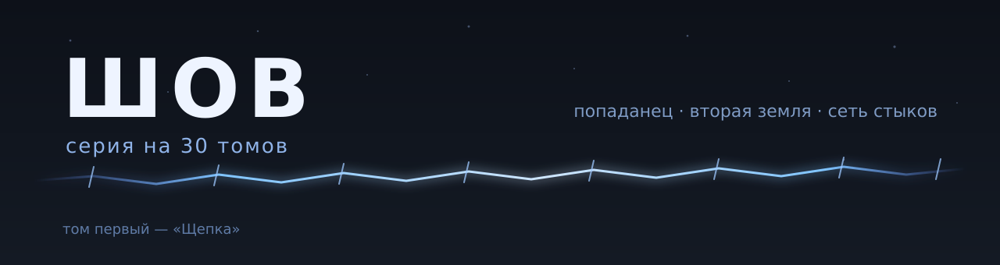</p>

<p align="center">
  
  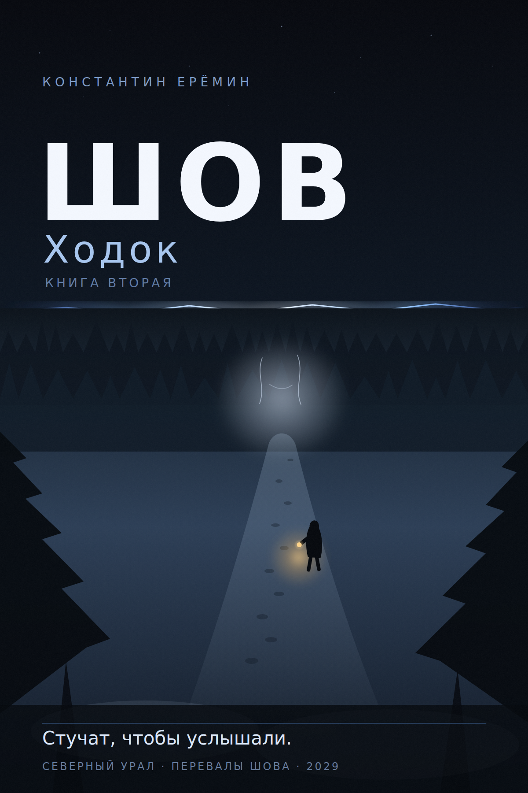
  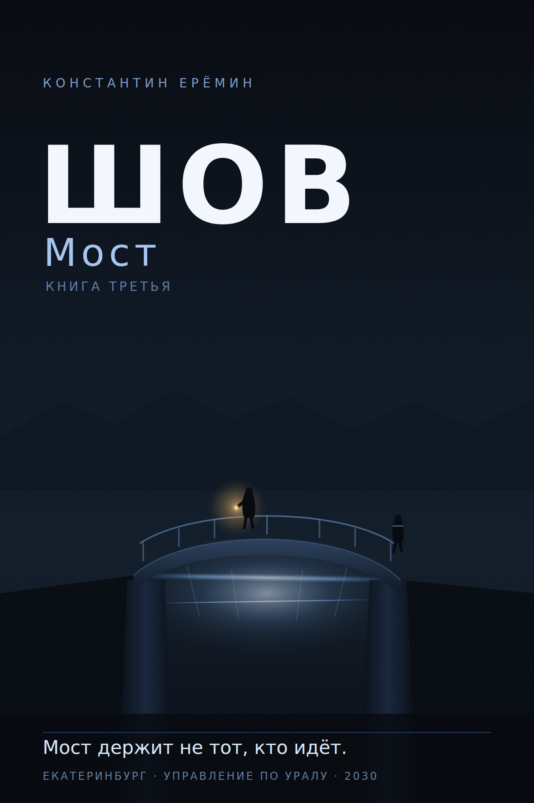
  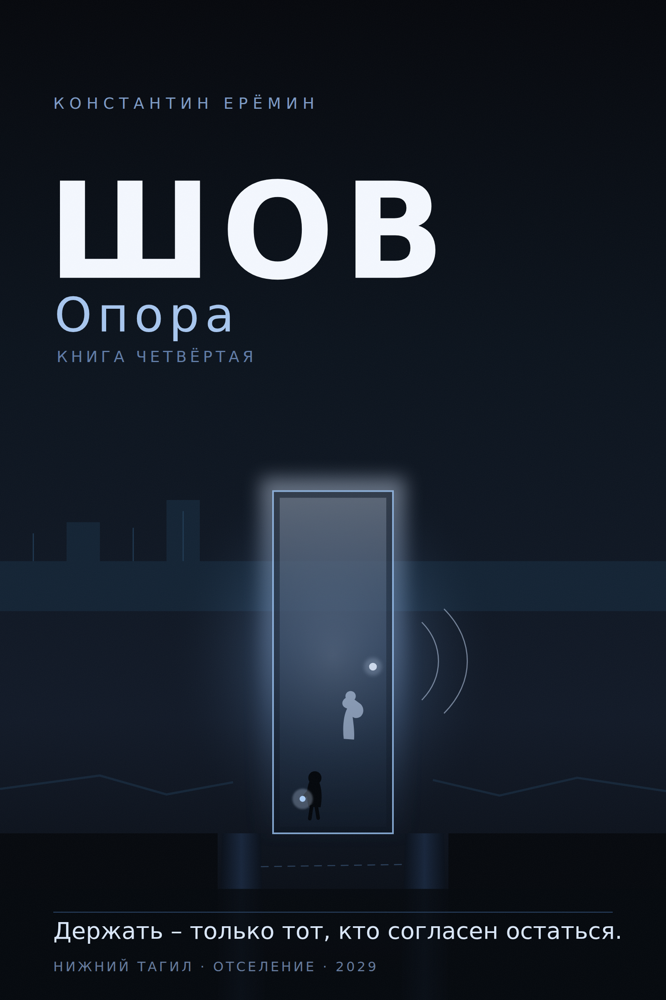
  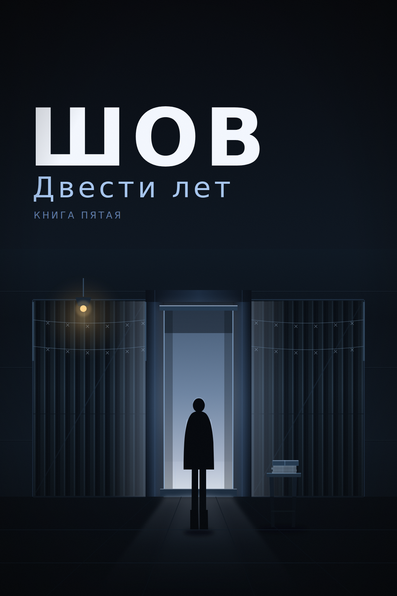
  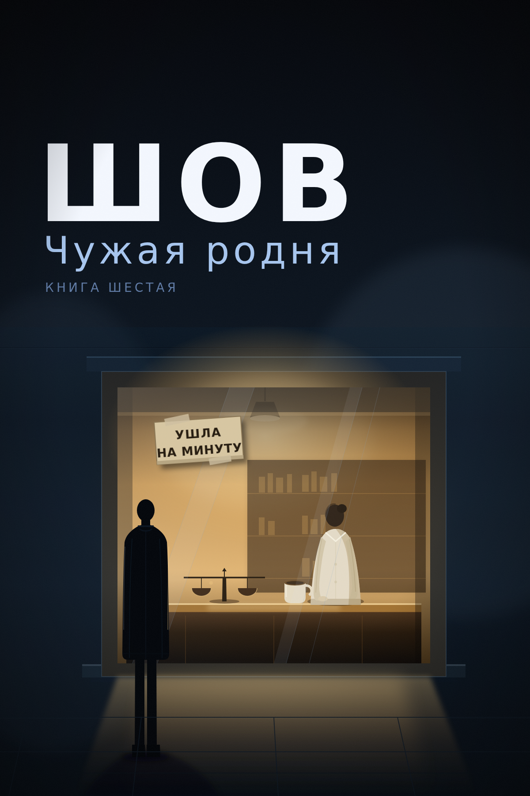
  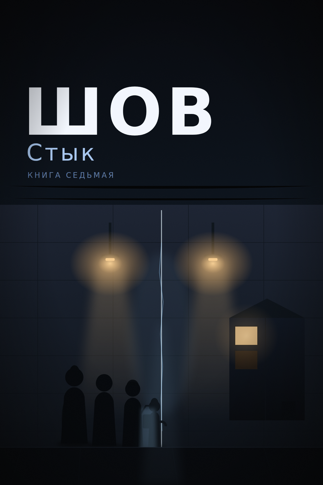
  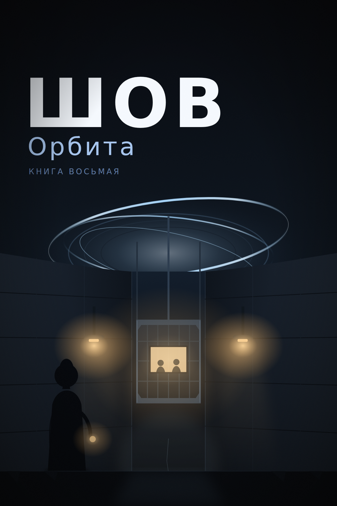
  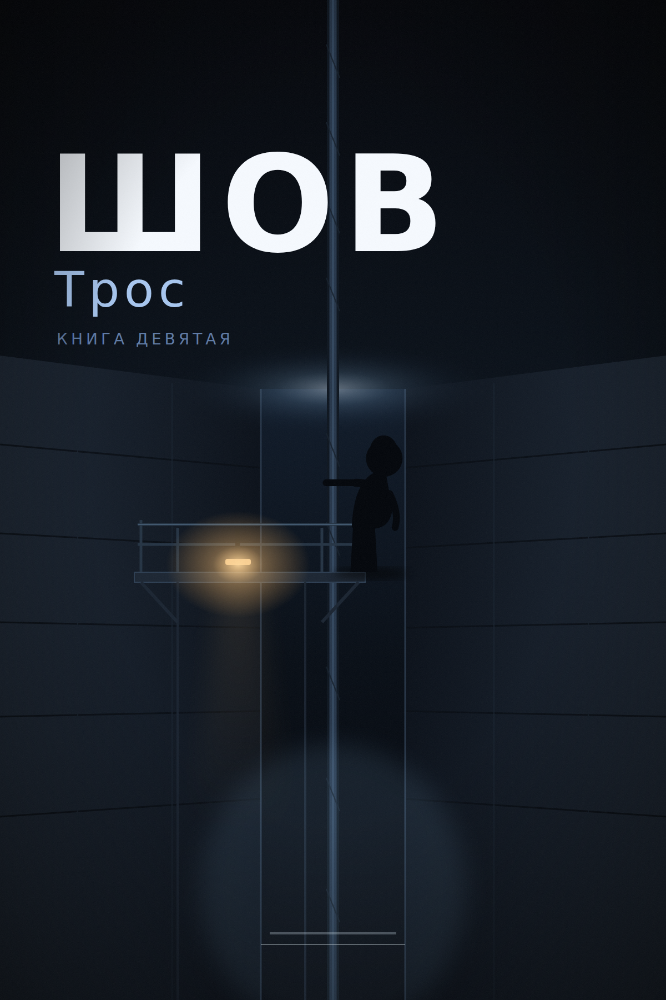
  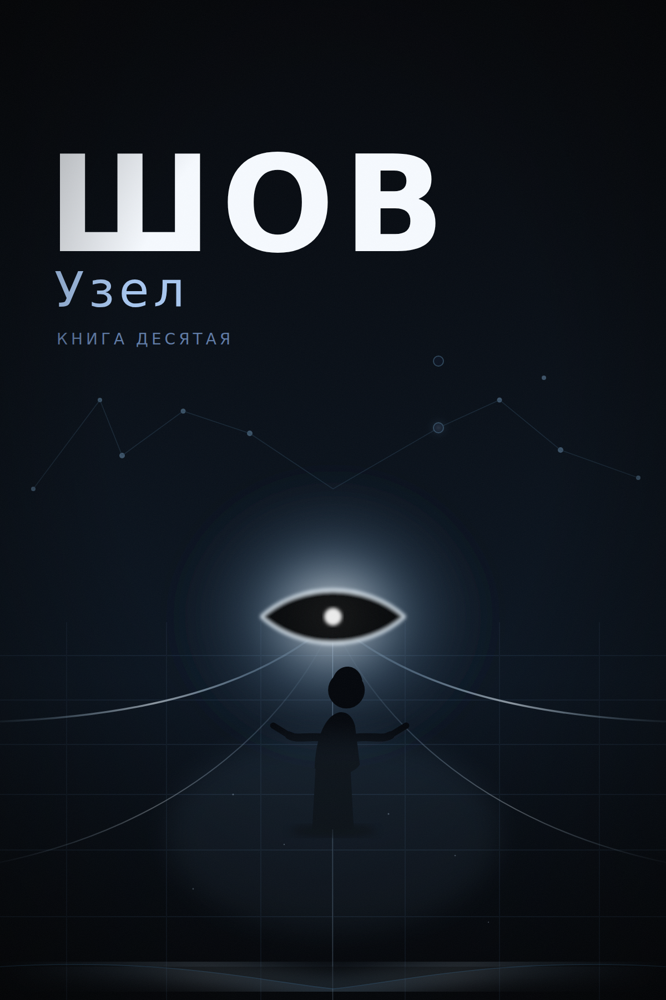
</p>

<h1 align="center">Шов</h1>
<p align="center"><b>Книга первая. Щепка</b> · <b>Книга вторая. Ходок</b> · <b>Книга третья. Мост</b> · <b>Книга четвёртая. Опора</b> · <b>Книга пятая. Двести лет</b> · <b>Книга шестая. Чужая родня</b> · <b>Книга седьмая. Стык</b> · <b>Книга восьмая. Орбита</b> · <b>Книга девятая. Трос</b> · <b>Книга десятая. Узел</b> · Константин Ерёмин</p>

<p align="center">
  <b>RU</b> · <a href="#english">English</a>
</p>

<p align="center">
  
  
  
  
  
  
  
  
  
  
  
  
  
  
  
  
</p>

**Разделы:** [⬇ Скачать](https://github.com/rukazax/shov/releases/tag/v1.0) · [🎧 Аудио тома 1](https://github.com/rukazax/shov/releases/tag/v1.1) · [🎧 Аудио тома 2](https://github.com/rukazax/shov/releases/tag/v2.1) · [О книге](#о-книге) · [Как устроен мир](#как-устроен-мир) · [План серии](#план-серии) · [Том первый](#том-первый-щепка) · [Том второй](#том-второй-ходок) · [Том третий](#том-третий-мост) · [Том четвёртый](#том-четвёртый-опора) · [Том пятый](#том-пятый-двести-лет) · [Том шестой](#том-шестой-чужая-родня) · [Том седьмой](#том-седьмой-стык) · [Том восьмой](#том-восьмой-орбита) · [Том девятый](#том-девятый-трос) · [Том десятый](#том-десятый-узел) · [Оглавление](#оглавление) · [Аудио](#аудио) · [Как делается том](#как-делается-том) · [Сборка](#сборка) · [Структура](#структура) · [English](#english)

---

## О книге

<p align="center"><a href="https://github.com/rukazax/shov/releases/tag/v1.0"><b>⬇ Том 1 «Щепка»</b></a> · <a href="https://github.com/rukazax/shov/releases/tag/v1.1"><b>🎧 Аудио тома 1: 34 дорожки, 14 ч 57 мин</b></a> · <a href="https://github.com/rukazax/shov/releases/tag/v2.0"><b>⬇ Том 2 «Ходок»</b></a> · <a href="https://github.com/rukazax/shov/releases/tag/v2.1"><b>🎧 Аудио тома 2: 34 дорожки, 16 ч 01 мин</b></a> · <a href="https://github.com/rukazax/shov/releases/tag/v3.0"><b>⬇ Том 3 «Мост»</b></a> · <a href="https://github.com/rukazax/shov/releases/tag/v4.0"><b>⬇ Том 4 «Опора»</b></a> · <a href="https://github.com/rukazax/shov/releases/tag/v5.0"><b>⬇ Том 5 «Двести лет»</b></a> · <a href="https://github.com/rukazax/shov/releases/tag/v6.0"><b>⬇ Том 6 «Чужая родня»</b></a> · <a href="https://github.com/rukazax/shov/releases/tag/v7.0"><b>⬇ Том 7 «Стык»</b></a> · <a href="https://github.com/rukazax/shov/releases/tag/v8.0"><b>⬇ Том 8 «Орбита»</b></a><br>EPUB · единый markdown · обложка · аудио отдельными файлами в релизах v1.1 и v2.1</p>

Двенадцатого августа 2019 года над Северным Уралом в небе появилась полоса: двенадцать километров длиной, сто пятьдесят метров шириной. Не портал, не дыра и не разлом — **стык двух реальностей с разной геометрией**. Через него сочится чужая геометрия, а иногда просачиваются люди.

По ту сторону — не чужой мир, а такая же Земля. Только Шов открылся там на двести двадцать лет раньше: успели построить орбитальные лифты, дважды воевали за узлы и почти убили себя. Сейчас у них тот же 2029 год, что и у нас, и они очень хотят знать, где мы были эти двести лет.

Семён Лоскутов, мастер по ремонту лифтов из Нижнего Тагила, лезет в заброшенную шахту за котом бабушки — и проваливается через протечку. Возвращается другим человеком: с меткой **проводника**, рангом «щепка», правом на одно согласование в день и вопросом, на который никто не отвечает. Что будет, когда Шов дорастёт до города?

Книга написана в стилистике Михаила Атаманова, серия «Искажающие реальность». Это **не** произведение автора: мир, имена и сюжет новые. Голос серии снят с тринадцати томов — стилевой паспорт остался в рабочем пространстве и в репозиторий не входит.

Главное отличие от «Искажающих реальность»: там контакт и игру навязывают извне, а здесь герой смотрит на собственное отражение через двести лет и сам решает, стоит ли догонять тех, кто догнал и почти погиб.

## Как устроен мир

| Понятие | Что это на деле |
|---|---|
| **Шов** | стык геометрий; растёт, пока его не согласуют, и дорастает до города за несколько месяцев |
| **Протечка** | место, где Шов тонкий: сорок метров вниз — и ты уже на той стороне |
| **Метка** | печать Стыка на человеке: пропускает через протечку, но отмечает как чужого для обеих сторон |
| **Согласование** | ремесло проводника: совместить две геометрии так, чтобы обе уцелели. Ошибка видна линейкой |
| **Щепка** | низший ранг проводника: одно согласование в день, износ мизерный, но и допуск — на порог |
| **Стык** | организация на той стороне, которая ставит метки. Ведомости не врут, но и не всё показывают |

Правила механики, имена и каркас глав — [BOOK01/BIBLE.md](BOOK01/BIBLE.md). Брифы глав — [BOOK01/BRIEF.md](BOOK01/BRIEF.md).

## План серии

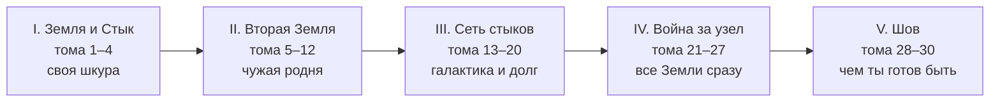

| Часть | Тома | Ставка |
|---|---|---|
| I. Земля и Стык | 1–4 | своя шкура, работа, дочь |
| II. Вторая Земля | 5–12 | чужая война и собственная личность |
| III. Сеть стыков | 13–20 | галактика, долг, ремесло |
| IV. Война за узел | 21–27 | существование всех Земель |
| V. Финал | 28–30 | чем ты готов быть, чтобы шов держался |

**Готово:** тома 1–8 — «Щепка», «Ходок», «Мост», «Опора», «Двести лет», «Чужая родня», «Стык», «Орбита». Первая часть плана закрыта: своя шкура, работа и дочь отработаны от начала до двери. Вторая часть идёт третьей книгой: жизнь на Второй Земле, служба, которая здесь называется «Сшивка», и история их Шова через документы, а не через лекцию. Шестой том перевёл дверь в почту и выдал герою живую бабушку, мать, которая здесь не уходила, и жену, которая его никогда не встречала. Седьмой поставил его в службу Стыка, между «порядком» и людьми, и забрал право подписи. Восьмой нашёл второй выход из шва — вверх, к орбите, — и вернул ему дочь голосом по связи. Девятый вывел его на край троса, где шов держат руками и где человек без веса не считается человеком: книга про квоту, табель и то, что остаётся после подписи. Десятый свёл сеть: узлы, геометров, регламент и цену, которая считается временем, а не деньгами. Дальше по плану — том одиннадцатый.

Раскадровка на тридцать томов — [PLAN.md](PLAN.md). Идея мира и правила — [IDEA.md](IDEA.md).

## Том первый «Щепка»

| Параметр | Том 1 | Норма серии |
|---|---|---|
| Объём | **608 881 знак** (15,2 а.л.) | 588–624 тыс. |
| Без пробелов | 492 400 знаков | — |
| Глав | 33 + Введение | 26–37 |
| Средняя глава | 18,2 тыс. знаков | 16–23 тыс. |
| Слов | 101 695 | — |
| Сцен | 166 (5 на главу) | 3–6 на главу |
| Системных строк | 28 | ~1 на 3,8 тыс. знаков |
| Диалог | 50 % строк | 30–38 % |
| Средняя фраза | 7,9 слова | 12–16 |

Где книга вылезает из нормы — честно:

- **диалога больше** (50 % против 30–38 %): сцены держатся на разговоре, потому что рассказчик — сам герой и он всё время оценивает услышанное;
- **средняя фраза короче** (7,9 против 12–16 слов): сказывается такт «абзац-разбор → удар одной строкой», без этого голос серии не звучит;
- **системных строк меньше** (28 против ~160): в этом мире нет игровой системы. Справку выдаёт Стык, и только за поступок, а не за каждый шаг.

Всё остальное в коридоре: объём, число глав, размер главы, сцены, клиффхэнгер через главу, двойной в финале, одна глава от чужого POV (глава восемнадцатая, лейтенант Сшивки) и одна земная привязка в каждой главе.

### Оглавление

<details open>
<summary>34 файла, 608 881 знак</summary>

| # | Глава | Объём |
|---|---|---|
| 1 | Введение. Одиннадцать миллиметров | 8 тыс. |
| 2 | Глава первая. Ведомость на два лифта | 14 тыс. |
| 3 | Глава вторая. Кот не дурак | 18 тыс. |
| 4 | Глава третья. Сорок метров вниз | 17 тыс. |
| 5 | Глава четвёртая. Не наш Тагил | 18 тыс. |
| 6 | Глава пятая. Хлеб без соли | 17 тыс. |
| 7 | Глава шестая. Три дня и шесть часов | 18 тыс. |
| 8 | Глава седьмая. Метка | 18 тыс. |
| 9 | Глава восьмая. Согласование: четыре и две | 18 тыс. |
| 10 | Глава девятая. Разговор у бабушки | 18 тыс. |
| 11 | Глава десятая. Контракт с приложением | 18 тыс. |
| 12 | Глава одиннадцатая. Нулевой километр | 17 тыс. |
| 13 | Глава двенадцатая. Ходьба с закрытыми глазами | 17 тыс. |
| 14 | Глава тринадцатая. Первый образец | 18 тыс. |
| 15 | Глава четырнадцатая. Одиннадцать миллиметров | 18 тыс. |
| 16 | Глава пятнадцатая. Боцман | 18 тыс. |
| 17 | Глава шестнадцатая. Тонкое место | 18 тыс. |
| 18 | Глава семнадцатая. Погоня на той стороне | 18 тыс. |
| 19 | Глава восемнадцатая. Лейтенант | 18 тыс. |
| 20 | Глава девятнадцатая. Ведомости не врут | 18 тыс. |
| 21 | Глава двадцатая. Мухин | 18 тыс. |
| 22 | Глава двадцать первая. Караван из трёх | 17 тыс. |
| 23 | Глава двадцать вторая. Компас | 18 тыс. |
| 24 | Глава двадцать третья. Домой | 17 тыс. |
| 25 | Глава двадцать четвёртая. Даша спрашивает | 18 тыс. |
| 26 | Глава двадцать пятая. Чужая подпись | 17 тыс. |
| 27 | Глава двадцать шестая. Крыша | 18 тыс. |
| 28 | Глава двадцать седьмая. Обратный ход | 18 тыс. |
| 29 | Глава двадцать восьмая. Своими ногами | 18 тыс. |
| 30 | Глава двадцать девятая. Стык закрывает двери | 17 тыс. |
| 31 | Глава тридцатая. Кто здесь был | 18 тыс. |
| 32 | Глава тридцать первая. Не ты | 18 тыс. |
| 33 | Глава тридцать вторая. Щепка, которая держит | 17 тыс. |
| 34 | Глава тридцать третья. Тише едешь | 17 тыс. |

</details>

Читать целиком: [BOOK01/SHOV-tom1.md](BOOK01/SHOV-tom1.md) — единый файл с содержанием и эпиграфом. EPUB для читалки — в [релизе](https://github.com/rukazax/shov/releases).

## Том второй «Ходок»

Ставка тома — люди в караване. Скоба на «Капитальной» поставлена и тянет; город начинает мелко ломаться (лифты, вода, часы). Из-за плёнки стучат, Стык отправляет группу на контакт — и операция проваливается: напарник гибнет, караван разбегается, Семён выводит троих своим ходом. Компас, который на той стороне показывал тонкость, дома впервые оживает — и показывает на Дашу.

| Параметр | Том 2 | Норма серии |
|---|---|---|
| Объём | **620 036 знаков** (15,5 а.л.) | 588–624 тыс. |
| Без пробелов | 499 137 знаков | — |
| Глав | 33 + Введение | 26–37 |
| Средняя глава | 18,2 тыс. знаков | 16–23 тыс. |
| Слов | 101 885 | — |
| Сцен | 173 (5 на главу) | 3–6 на главу |
| Системных строк | 23 | ~1 на 4 тыс. знаков |
| Диалог | 61 % строк | 30–38 % |
| Средняя фраза | 7,0 слова | 12–16 |

Где том вылезает из нормы — честно:

- **диалога ещё больше, чем в первом** (61 % против 50 %): задача тома была «человечнее», и половина сцен держится на разговоре — в шахте, в лесу, на кухне;
- **средняя фраза короче** (7,0): тот же такт «абзац-разбор → удар одной строкой»;
- **системных строк меньше** (23): справку по-прежнему выдаёт Стык и только за поступок.

Что нового в томе: смотритель края «4-бис» Пётр Ильич Ветров (он же голос Введения и главы восемнадцатой — единственный чужой POV), старший сержант Тимур Гущин, геометр Ирина Ковалёва, наблюдатель Кирилл Сомов. Гибнет не «кто-то», а человек с именем, женой и восьмимесячной дочерью — и том помнит об этом до последней главы.

<details>
<summary>Оглавление тома 2 — 34 файла, 620 036 знаков</summary>

| # | Глава | Объём |
|---|---|---|
| 0 | Введение. Стекло толщиной в палец | 8 тыс. |
| 1 | Глава первая. Скоба | 21 тыс. |
| 2 | Глава вторая. Лифт идёт не туда | 18 тыс. |
| 3 | Глава третья. Ведомость на скобу | 17 тыс. |
| 4 | Глава четвёртая. Три удара | 19 тыс. |
| 5 | Глава пятая. Кто там | 17 тыс. |
| 6 | Глава шестая. Сборы | 18 тыс. |
| 7 | Глава седьмая. Нулевой километр | 19 тыс. |
| 8 | Глава восьмая. Перед броском | 18 тыс. |
| 9 | Глава девятая. Переход в группе | 18 тыс. |
| 10 | Глава десятая. Чужой наряд | 20 тыс. |
| 11 | Глава одиннадцатая. Смотритель | 19 тыс. |
| 12 | Глава двенадцатая. Разговор через плёнку | 18 тыс. |
| 13 | Глава тринадцатая. Приказ | 17 тыс. |
| 14 | Глава четырнадцатая. Образец | 17 тыс. |
| 15 | Глава пятнадцатая. Погоня | 18 тыс. |
| 16 | Глава шестнадцатая. Гущин | 17 тыс. |
| 17 | Глава семнадцатая. Трое | 18 тыс. |
| 18 | Глава восемнадцатая. Смотритель | 19 тыс. |
| 19 | Глава девятнадцатая. Обратный ход | 20 тыс. |
| 20 | Глава двадцатая. Скоба треснула | 17 тыс. |
| 21 | Глава двадцать первая. Вышли | 19 тыс. |
| 22 | Глава двадцать вторая. Ведомость на троих | 17 тыс. |
| 23 | Глава двадцать третья. Разбор | 17 тыс. |
| 24 | Глава двадцать четвёртая. Даша | 17 тыс. |
| 25 | Глава двадцать пятая. Хранилище | 17 тыс. |
| 26 | Глава двадцать шестая. Указатель | 17 тыс. |
| 27 | Глава двадцать седьмая. Тонкое место | 18 тыс. |
| 28 | Глава двадцать восьмая. Садик | 17 тыс. |
| 29 | Глава двадцать девятая. Бабушка знает | 17 тыс. |
| 30 | Глава тридцатая. Фотография | 21 тыс. |
| 31 | Глава тридцать первая. Приказ на Дашу | 20 тыс. |
| 32 | Глава тридцать вторая. Не отдам | 19 тыс. |
| 33 | Глава тридцать третья. Ходок | 17 тыс. |

</details>

Читать целиком: [BOOK02/SHOV-tom2.md](BOOK02/SHOV-tom2.md) — единый файл с содержанием и эпиграфом. EPUB — в [релизе v2.0](https://github.com/rukazax/shov/releases/tag/v2.0). Библия тома — [BOOK02/BIBLE.md](BOOK02/BIBLE.md), брифы — [BOOK02/BRIEFS](BOOK02/BRIEFS).


## Том третий «Мост»

Ставка тома — должность. «Мост» здесь не сооружение и не метафора, а место работы: человек, который переводит людей и грузы через Шов и отвечает за них головой. Семёну её предлагают после первого каравана — и предлагают так, что отказаться неудобно, а согласиться нельзя.

Дальше том идёт двумя линиями, как рельсы. В управлении — медкомиссия, допуск, ведомость на караван и три окна согласования в день: бумага решает больше, чем смелость. С той стороны — человек в форме, который знает про Семёна больше, чем сам Семён. У него своя бумага, свой срок в четыре года и просьба: не открывать, а закрыть. В обмен он даёт то, чего здесь не дают: ответ про прадеда, цифры, которые не сходятся, и год, который обещали.

К середине становится ясно, что решают не инженеры и не начальство, а тот, кто поставит подпись. Вот только подпись ищет хозяина.

**Что внутри:** 609 337 знаков, 99 117 слов, 15,2 а.л.; 34 главы (Введение + 33); 181 сцена; 74 системные строки — одна на 8,2 тыс. знаков; диалог 64 % строк, средняя фраза 7,2 слова.

<details>
<summary>Оглавление тома 3 — 34 файла, 609 337 знаков</summary>

| # | Глава | Объём |
|---|---|---|
| 0 | Введение. Стекло толщиной в палец | 7 тыс. |
| 1 | Глава первая. Допуск | 18 тыс. |
| 2 | Глава вторая. Согласование у секретаря | 18 тыс. |
| 3 | Глава третья. Ведомость на караван | 19 тыс. |
| 4 | Глава четвёртая. Седьмой | 19 тыс. |
| 5 | Глава пятая. Письмо в столбе | 19 тыс. |
| 6 | Глава шестая. Первый класс | 17 тыс. |
| 7 | Глава седьмая. Три окна | 17 тыс. |
| 8 | Глава восьмая. Мост | 17 тыс. |
| 9 | Глава девятая. Нулевой километр | 19 тыс. |
| 10 | Глава десятая. Тишина вместо дыры | 18 тыс. |
| 11 | Глава одиннадцатая. Та сторона | 19 тыс. |
| 12 | Глава двенадцатая. Нина | 18 тыс. |
| 13 | Глава тринадцатая. Груз | 19 тыс. |
| 14 | Глава четырнадцатая. Поломка | 19 тыс. |
| 15 | Глава пятнадцатая. Человек в форме | 18 тыс. |
| 16 | Глава шестнадцатая. Водонапорная | 18 тыс. |
| 17 | Глава семнадцатая. Обратный ход | 17 тыс. |
| 18 | Глава восемнадцатая. Отчёт | 18 тыс. |
| 19 | Глава девятнадцатая. Прецедент | 18 тыс. |
| 20 | Глава двадцатая. Кержак | 18 тыс. |
| 21 | Глава двадцать первая. Жетон | 19 тыс. |
| 22 | Глава двадцать вторая. Дома | 18 тыс. |
| 23 | Глава двадцать третья. Три подписи | 18 тыс. |
| 24 | Глава двадцать четвёртая. Щепка или мост | 19 тыс. |
| 25 | Глава двадцать пятая. Вода в стене | 19 тыс. |
| 26 | Глава двадцать шестая. Расчёт | 18 тыс. |
| 27 | Глава двадцать седьмая. Список | 18 тыс. |
| 28 | Глава двадцать восьмая. Второй караван | 19 тыс. |
| 29 | Глава двадцать девятая. Гость | 19 тыс. |
| 30 | Глава тридцатая. Кто подпишет | 18 тыс. |
| 31 | Глава тридцать первая. Приказ | 18 тыс. |
| 32 | Глава тридцать вторая. Ночь в управлении | 17 тыс. |
| 33 | Глава тридцать третья. Мост держит | 16 тыс. |

</details>

Читать целиком: [BOOK03/SHOV-tom3.md](BOOK03/SHOV-tom3.md) — единый файл с содержанием и эпиграфом. EPUB — в [релизе v3.0](https://github.com/rukazax/shov/releases/tag/v3.0). Библия тома — [BOOK03/BIBLE.md](BOOK03/BIBLE.md), брифы — [BOOK03/BRIEFS](BOOK03/BRIEFS).

## Том четвёртый «Опора»

Ставка тома — ремесло. Закрытие назначено, и назначил его не тот, кто мог. Приказ, который Семён отказался подписывать, подписал кто-то другой — и вышло хуже отказа: город отселяют по расписанию, а в сводках пишут «оползневые явления техногенного характера» вместо «шов тянет неровно».

Город трясёт с марта. Сейсмолог Ася Ткачук приносит цифру, которой нет в сводках: 4,6 вместо 3,2. Кержак говорит, что штольня дышит. Бабушка — что дом держит, пока в нём кто-то спит. А с той стороны приходит старик по фамилии Сколков, последний сшивальщик, который умеет не вязать узлы, а держать шов собой. Скобу варит сварщик, нить считает геометр, а держит человек — и держит не силой, а тем, что не уходит.

Восемь глав подряд никто не побеждает: все учатся. За это том платит дорого — толчком в четыре минуты, списком из четырнадцати фамилий и одной парой рук, которая после пробы перестаёт слушаться.

Чем кончается: дверью. Шов не закрылся и не открылся — он встал между автобусной остановкой и столбом, и его видно с улицы. У двери стоит ребёнок и держит ладонь там, где должна быть ручка. С той стороны стучат.

**Что внутри:** 600 431 знак, 97 166 слов, 15,0 а.л.; 34 главы (Введение + 33); 149 сцен; 162 системные строки — одна на 3,7 тыс. знаков; диалог 62 % строк, средняя фраза 7,5 слова.

<details>
<summary>Оглавление тома 4 — 34 файла, 600 431 знак</summary>

| # | Глава | Объём |
|---|---|---|
| 0 | Введение. Шесть человек и один шов | 7 тыс. |
| 1 | Глава первая. Подпись | 18 тыс. |
| 2 | Глава вторая. Кто подписал | 18 тыс. |
| 3 | Глава третья. Первый толчок | 17 тыс. |
| 4 | Глава четвёртая. Сводка | 18 тыс. |
| 5 | Глава пятая. Плановое отселение | 19 тыс. |
| 6 | Глава шестая. Дверь | 18 тыс. |
| 7 | Глава седьмая. Штольня дышит | 19 тыс. |
| 8 | Глава восьмая. Гость в гражданском | 18 тыс. |
| 9 | Глава девятая. Мастер | 19 тыс. |
| 10 | Глава десятая. Скоба | 18 тыс. |
| 11 | Глава одиннадцатая. Два прибора | 18 тыс. |
| 12 | Глава двенадцатая. Два рисунка | 18 тыс. |
| 13 | Глава тринадцатая. Седьмой | 18 тыс. |
| 14 | Глава четырнадцатая. Мёртвый край | 18 тыс. |
| 15 | Глава пятнадцатая. Руки мастера | 18 тыс. |
| 16 | Глава шестнадцатая. Сомов узнаёт | 18 тыс. |
| 17 | Глава семнадцатая. Пока не поздно | 19 тыс. |
| 18 | Глава восемнадцатая. Толчок | 18 тыс. |
| 19 | Глава девятнадцатая. Список | 18 тыс. |
| 20 | Глава двадцатая. Виноватые | 18 тыс. |
| 21 | Глава двадцать первая. Очередь | 19 тыс. |
| 22 | Глава двадцать вторая. Даша уезжает | 17 тыс. |
| 23 | Глава двадцать третья. Дом держит | 18 тыс. |
| 24 | Глава двадцать четвёртая. Последняя партия | 19 тыс. |
| 25 | Глава двадцать пятая. Держать собой | 18 тыс. |
| 26 | Глава двадцать шестая. Приказ об опоре | 17 тыс. |
| 27 | Глава двадцать седьмая. Ночь перед | 18 тыс. |
| 28 | Глава двадцать восьмая. Сшивка | 17 тыс. |
| 29 | Глава двадцать девятая. Три секунды | 17 тыс. |
| 30 | Глава тридцатая. Первая минута | 17 тыс. |
| 31 | Глава тридцать первая. Вторая минута | 18 тыс. |
| 32 | Глава тридцать вторая. Дверь осталась | 17 тыс. |
| 33 | Глава тридцать третья. Стук | 17 тыс. |

</details>

Читать целиком: [BOOK04/SHOV-tom4.md](BOOK04/SHOV-tom4.md) — единый файл с содержанием и эпиграфом. EPUB — в [релизе v4.0](https://github.com/rukazax/shov/releases/tag/v4.0). Библия тома — [BOOK04/BIBLE.md](BOOK04/BIBLE.md), брифы — [BOOK04/BRIEFS](BOOK04/BRIEFS), спина глав — [BOOK04/SPINE.md](BOOK04/SPINE.md).

## Том пятый «Двести лет»

Ставка тома — дом, которого больше нет. Шов сшили, и он стал дверью: не открылся и не закрылся, а встал в бетонной камере, которую снаружи обшили профлистом и обнесли колючкой. Теперь через него ходят по списку, по наряду, два раза в сутки. Семён переходит на ту сторону не ходоком, а человеком, которого туда оформили: пропуск, наряд, допуск, разряд.

Там та же страна с другим именем: Верхний Завод вместо Нижнего Тагила, Сшивка вместо Стыка. Те же лица с другими судьбами, и узнавать своих — работа, а не радость. И там лежит Свод: сто двадцать листов на двести лет, восемь фамилий сшивальщиков, и у каждой записано, сколько держал и чем заплатил. Девятая строка пустая, но с датой. Дата — прошлый год.

Дверь держат не силой. Дверь держат тем, что не уходишь один. Вот только чужой дом берёт за постой: сначала уходят запахи, потом лица соседей, потом названия улиц, потом номер своей квартиры. Через полгода человек помнит, что у него был дом, и не помнит, где.

Это том про бумагу. Про то, что в описи нет ничего, чего нельзя было бы переписать, и что стоит это дешевле, чем кажется, пока не дойдёт до девятой строки.

Чем кончается: бетоном у объездной, рисунком на девять фигур и подписью под первым листом 1826 года, которую двести лет никто не читал до конца.

**Что внутри:** 607 528 знаков, 99 554 слова, 15,2 а.л.; 34 главы (Введение + 33); 143 сцены; 141 системная строка — одна на 4,3 тыс. знаков; диалог 41 % строк, средняя фраза 9,2 слова.

<details>
<summary>Оглавление тома 5 — 34 файла, 607 528 знаков</summary>

| # | Глава | Объём |
|---|---|---|
| 0 | Введение. Скоба на Медном руднике | 7 тыс. |
| 1 | Глава первая. Проходная | 19 тыс. |
| 2 | Глава вторая. Список | 18 тыс. |
| 3 | Глава третья. Ведомость детей | 18 тыс. |
| 4 | Глава четвёртая. Боцман | 17 тыс. |
| 5 | Глава пятая. Наряд | 19 тыс. |
| 6 | Глава шестая. Верхний Завод | 19 тыс. |
| 7 | Глава седьмая. Свод | 18 тыс. |
| 8 | Глава восьмая. График | 19 тыс. |
| 9 | Глава девятая. 1826 | 19 тыс. |
| 10 | Глава десятая. Опись | 19 тыс. |
| 11 | Глава одиннадцатая. Подделка | 17 тыс. |
| 12 | Глава двенадцатая. Восемь | 17 тыс. |
| 13 | Глава тринадцатая. Смена | 18 тыс. |
| 14 | Глава четырнадцатая. Дом | 17 тыс. |
| 15 | Глава пятнадцатая. Край | 17 тыс. |
| 16 | Глава шестнадцатая. Даша | 17 тыс. |
| 17 | Глава семнадцатая. Допуск | 18 тыс. |
| 18 | Глава восемнадцатая. Дело № 44 | 17 тыс. |
| 19 | Глава девятнадцатая. Девятая строка | 17 тыс. |
| 20 | Глава двадцатая. Тихон | 19 тыс. |
| 21 | Глава двадцать первая. Скоба, которую не сшили | 19 тыс. |
| 22 | Глава двадцать вторая. Наряд на закрытие | 19 тыс. |
| 23 | Глава двадцать третья. Три вопроса | 19 тыс. |
| 24 | Глава двадцать четвёртая. Мать Нины | 18 тыс. |
| 25 | Глава двадцать пятая. Отказ | 18 тыс. |
| 26 | Глава двадцать шестая. Сделка | 18 тыс. |
| 27 | Глава двадцать седьмая. Ночь на посту | 18 тыс. |
| 28 | Глава двадцать восьмая. Палец | 19 тыс. |
| 29 | Глава двадцать девятая. Замер | 19 тыс. |
| 30 | Глава тридцатая. Подпись Пожарского | 19 тыс. |
| 31 | Глава тридцать первая. Ни закрыть, ни открыть | 19 тыс. |
| 32 | Глава тридцать вторая. Чужой почерк | 18 тыс. |
| 33 | Глава тридцать третья. Девятый лист | 17 тыс. |

</details>

Читать целиком: [BOOK05/SHOV-tom5.md](BOOK05/SHOV-tom5.md) — единый файл с содержанием и эпиграфом. EPUB — в [релизе v5.0](https://github.com/rukazax/shov/releases/tag/v5.0). Библия тома — [BOOK05/BIBLE.md](BOOK05/BIBLE.md), брифы — [BOOK05/BRIEFS](BOOK05/BRIEFS), спина глав — [BOOK05/SPINE.md](BOOK05/SPINE.md).

## Том шестой «Чужая родня»

Ставка тома — родня. Дверь к этому времени уже не открывается и не закрывается: она работает почтой. Наряд, пропуск, окошко, очередь. И первое, что выдают приезжему на той стороне, — не метку, а бланк.

Бюро родства ищет по фамилии, городу и году — и находит больше, чем просили. У Семёна там живая бабушка: та же Аграфена Прокопьевна, те же руки, только переулок такой, какого на его стороне нет. Мать, которая дома ушла из его детства, здесь никуда не уходила. Жена, которую он помнит своей, его здесь никогда не встречала.

Каждое родство стоит денег, и цена одна — дом. Не в смысле «где жить», а в смысле «где ты числишься»: приписка, графа, лист. Признать родню — значит вписать себя в чужую книгу и выписаться из своей. Вот только чужой лист держит крепче, чем родная память, и требует подписи.

Чем кончается: девятым листом, графой «цена» и отказом от приписки.

| Параметр | Том 6 | Норма серии |
|---|---|---|
| Объём | **610 541 знак** (15,3 а.л.) | 588–624 тыс. |
| Без пробелов | 496 087 знаков | — |
| Глав | 33 + Введение | 26–37 |
| Средняя глава | 18,3 тыс. знаков | 16–23 тыс. |
| Слов | 100 925 | — |
| Сцен | 139 (4 на главу) | 3–6 на главу |
| Системных строк | 68 | ~1 на 3,8 тыс. знаков |
| Диалог | 50 % строк | 30–38 % |
| Средняя фраза | 9,1 слова | 12–16 |

Где книга вылезает из нормы — честно:

- **диалога больше** (50 % против 30–38 %): том почти весь на разговорах — бюро, торг, чай у бабушки; родню герой узнаёт языком, а не бумагой;
- **средняя фраза короче** (9,1 против 12–16 слов): тот же такт серии, абзац-разбор и удар одной строкой, без него голос не звучит;
- **системных строк меньше** (68 против ~160): систему здесь вытеснили бумаги — бланк, лист, графа. Справку выдаёт ведомость, а не игровая строка.

Всё остальное в коридоре: объём, число глав, размер главы и сцены.

<details>
<summary>Оглавление тома 6 — 34 файла, 610 541 знак</summary>

| # | Глава | Объём |
|---|---|---|
| 0 | Введение. Отказ Аграфены Прокопьевны | 7 тыс. |
| 1 | Глава первая. Почта | 19 тыс. |
| 2 | Глава вторая. Бюро | 19 тыс. |
| 3 | Глава третья. Первый отказ | 19 тыс. |
| 4 | Глава четвёртая. Цена приближения | 18 тыс. |
| 5 | Глава пятая. Заявление принято | 18 тыс. |
| 6 | Глава шестая. Торг | 18 тыс. |
| 7 | Глава седьмая. Сборы | 17 тыс. |
| 8 | Глава восьмая. Адрес, которого нет | 17 тыс. |
| 9 | Глава девятая. Переулок | 19 тыс. |
| 10 | Глава десятая. Первое окно | 19 тыс. |
| 11 | Глава одиннадцатая. Три дня отказов | 18 тыс. |
| 12 | Глава двенадцатая. Право на визит | 18 тыс. |
| 13 | Глава тринадцатая. Доказательства | 18 тыс. |
| 14 | Глава четырнадцатая. Валентина Петровна | 18 тыс. |
| 15 | Глава пятнадцатая. Разговор | 18 тыс. |
| 16 | Глава шестнадцатая. Она не уходила | 18 тыс. |
| 17 | Глава семнадцатая. Чай у бабушки | 19 тыс. |
| 18 | Глава восемнадцатая. Цена визита | 19 тыс. |
| 19 | Глава девятнадцатая. Теплосеть | 19 тыс. |
| 20 | Глава двадцатая. Аркадий Ткач | 18 тыс. |
| 21 | Глава двадцать первая. Отказ в родстве | 18 тыс. |
| 22 | Глава двадцать вторая. Список | 19 тыс. |
| 23 | Глава двадцать третья. Письмо | 18 тыс. |
| 24 | Глава двадцать четвёртая. Даша | 18 тыс. |
| 25 | Глава двадцать пятая. Бланк приписного | 18 тыс. |
| 26 | Глава двадцать шестая. Признание | 18 тыс. |
| 27 | Глава двадцать седьмая. Просьба | 19 тыс. |
| 28 | Глава двадцать восьмая. Две бабушки | 18 тыс. |
| 29 | Глава двадцать девятая. Письмо без веса | 19 тыс. |
| 30 | Глава тридцатая. Полоса | 19 тыс. |
| 31 | Глава тридцать первая. Отказ от приписки | 19 тыс. |
| 32 | Глава тридцать вторая. Графа «цена» | 19 тыс. |
| 33 | Глава тридцать третья. Девятый лист | 16 тыс. |

</details>

Читать целиком: [BOOK06/SHOV-tom6.md](BOOK06/SHOV-tom6.md) — единый файл с содержанием и эпиграфом. EPUB — в [релизе v6.0](https://github.com/rukazax/shov/releases/tag/v6.0). Библия тома — [BOOK06/BIBLE.md](BOOK06/BIBLE.md), брифы — [BOOK06/BRIEFS](BOOK06/BRIEFS), спина глав — [BOOK06/SPINE.md](BOOK06/SPINE.md). Озвучки пока нет: пойдёт тем же конвейером, `BOOK=BOOK06 ./audio/render_all.sh`.

## Том седьмой «Стык»

Ставка тома — подпись. Семён уже не гость и не ходок: у него допуск, смена и служба, которая называется Стык. У службы две фракции, и обе по-своему правы: «порядок» считает дверь объектом, а у объекта есть регламент и одиннадцать часов на закрытие; «люди» считают фамилии в листе ожидания, а за дверью на той стороне стоит четырнадцать человек.

Дальше том идёт, как приёмка: лист, приёмка, протокол, акт. Каждый документ честен по отдельности, и вместе они дают приказ закрыть дверь на одиннадцать часов — ровно тогда, когда на той стороне четырнадцать. Подписать — значит согласиться, что четырнадцать подождут. Не подписать — значит потерять право подписи и допуск, то есть работу, которой он и стал нужен.

Он не подписывает. Служба забирает подпись, потом допуск; фракции меняются местами в своих правах, а очередь у двери становится короче на четырнадцать фамилий, и это не победа, а бумага.

Чем кончается: через стык проходит его дочь.

| Параметр | Том 7 | Норма серии |
|---|---|---|
| Объём | **612 983 знака** (15,3 а.л.) | 588–624 тыс. |
| Без пробелов | 498 355 знака | — |
| Глав | 33 + Введение | 26–37 |
| Средняя глава | 18,3 тыс. знаков | 16–23 тыс. |
| Слов | 100 145 | — |
| Сцен | 162 (5 на главу) | 3–6 на главу |
| Системных строк | 124 | ~1 на 3,8 тыс. знаков |
| Диалог | 49 % строк | 30–38 % |
| Средняя фраза | 8,7 слова | 12–16 |

Где книга вылезает из нормы — честно:

- **диалога больше** (49 % против 30–38 %): служба говорит приказами, протоколами и приёмкой, а герой отвечает вслух, потому что подпись молча не ставится;
- **средняя фраза короче** (8,7 против 12–16 слов): такт серии держится, удар одной строкой здесь короче обычного.

Системных строк 124 — одна на 4,9 тыс. знаков: чуть реже нормы, потому что их место заняли приказы. Всё остальное в коридоре: объём, число глав, размер главы и сцены.

<details>
<summary>Оглавление тома 7 — 34 файла, 612 983 знака</summary>

| # | Глава | Объём |
|---|---|---|
| 0 | Введение. Одиннадцать часов | 8 тыс. |
| 1 | Глава первая. «Шаг» | 18 тыс. |
| 2 | Глава вторая. «Лицо» | 18 тыс. |
| 3 | Глава третья. «Перевод» | 18 тыс. |
| 4 | Глава четвёртая. «Присяга» | 18 тыс. |
| 5 | Глава пятая. «Лист» | 19 тыс. |
| 6 | Глава шестая. «Приёмка» | 18 тыс. |
| 7 | Глава седьмая. «Где ты живёшь» | 17 тыс. |
| 8 | Глава восьмая. «Журнал» | 18 тыс. |
| 9 | Глава девятая. «Будка» | 18 тыс. |
| 10 | Глава десятая. «Список Пожарской» | 18 тыс. |
| 11 | Глава одиннадцатая. «Цена часов» | 19 тыс. |
| 12 | Глава двенадцатая. «Лист ожидания» | 19 тыс. |
| 13 | Глава тринадцатая. «Сшились не туда» | 19 тыс. |
| 14 | Глава четырнадцатая. «Он не тот» | 18 тыс. |
| 15 | Глава пятнадцатая. «Кто платит» | 18 тыс. |
| 16 | Глава шестнадцатая. «Записки» | 18 тыс. |
| 17 | Глава семнадцатая. «Ночная смена» | 18 тыс. |
| 18 | Глава восемнадцатая. «Сколкова» | 19 тыс. |
| 19 | Глава девятнадцатая. «Приказ на закрытие» | 19 тыс. |
| 20 | Глава двадцатая. «Ночь перед» | 18 тыс. |
| 21 | Глава двадцать первая. «Протокол» | 19 тыс. |
| 22 | Глава двадцать вторая. «Его подпись» | 19 тыс. |
| 23 | Глава двадцать третья. «Отказ» | 18 тыс. |
| 24 | Глава двадцать четвёртая. «Голос за дверью» | 18 тыс. |
| 25 | Глава двадцать пятая. «Исполнение» | 19 тыс. |
| 26 | Глава двадцать шестая. «Право подписи» | 18 тыс. |
| 27 | Глава двадцать седьмая. «Разбор» | 18 тыс. |
| 28 | Глава двадцать восьмая. «Очередь стала короче» | 19 тыс. |
| 29 | Глава двадцать девятая. «Даша у стыка» | 18 тыс. |
| 30 | Глава тридцатая. «Наша бабушка» | 18 тыс. |
| 31 | Глава тридцать первая. «Восемь фигур» | 18 тыс. |
| 32 | Глава тридцать вторая. «Сорок седьмой лист» | 18 тыс. |
| 33 | Глава тридцать третья. «Порог» | 18 тыс. |

</details>

Читать целиком: [BOOK07/SHOV-tom7.md](BOOK07/SHOV-tom7.md) — единый файл с содержанием и эпиграфом. EPUB — в [релизе v7.0](https://github.com/rukazax/shov/releases/tag/v7.0). Библия тома — [BOOK07/BIBLE.md](BOOK07/BIBLE.md), брифы — [BOOK07/BRIEFS](BOOK07/BRIEFS), спина глав — [BOOK07/SPINE.md](BOOK07/SPINE.md). Озвучки пока нет: пойдёт тем же конвейером, `BOOK=BOOK07 ./audio/render_all.sh`.

## Том восьмой «Орбита»

Ставка тома — вес. Вбок его больше не пускают: приписного дверь не берёт, допуск снят, и он живёт на подъёмные, а к стыку ходит, как в музей. А потом выясняется то, о чём в службе знали всегда, а он не спрашивал: у шва два выхода. Второй ведёт вверх — в той же шахте, где у нас клеть ходит вниз, за водой, у них она ходит вверх, к орбите Второй Земли. Триста километров, шесть часов сорок минут.

Поднимают по весу, а не по родству: капсула берёт четыреста двадцать килограммов, человек с сумкой идёт за двоих, очередь двигается раз в три месяца. Вне очереди поднимают троих — врача, инспектора и сопровождающего, того, кто летит с несовершеннолетним. Семён берёт чужого ребёнка как основание: Тим Сомов, четырнадцать лет, сорок два килограмма, боится высоты и не признаётся. Впервые он не пострадавший в бумаге, а её автор.

Перед подъёмом — четырнадцать суток карантина, и карантин не про заразу: он про то, чтобы человек успел передумать и чтобы служба успела записать, зачем он летит. В журнале одна графа — «цель». Врачи в неё не верят, но пишут.

Наверху шов выходит в пустоту и там не растёт: его держат с двух сторон. Верхний стык — станция из четырёх отсеков, своя опись, свой лист и своя девятая строка, где его имя стоит раньше, чем он его туда вписал. Чем кончается: клеть уходит вниз без него, а по связи он слышит голос Даши — она наверху, но не там, где он искал.

| Параметр | Том 8 | Норма серии |
|---|---|---|
| Объём | **609 720 знаков** (15,2 а.л.) | 588–624 тыс. |
| Без пробелов | 494 411 знаков | — |
| Глав | 33 + Введение | 26–37 |
| Средняя глава | 17,9 тыс. знаков | 16–23 тыс. |
| Слов | 100 251 слово | — |
| Сцен | 154 (4–5 на главу) | 3–6 на главу |
| Системных строк | 112 | ~1 на 3,8 тыс. знаков |
| Диалог | 51 % строк | 30–38 % |
| Средняя фраза | 8,7 слова | 12–16 |

Где книга вылезает из нормы — честно:

- **диалога больше** (51 % против 30–38 %): половина тома проходит в капсуле, где шесть человек и один кислородный баллон на всех, — там нечего делать, кроме как говорить;
- **средняя фраза короче** (8,7 против 12–16 слов): в карантине и в клети люди отвечают коротко, потому что время считают по часам, а не по абзацам.

Системных строк 112 — одна на 5,4 тыс. знаков: реже нормы, потому что их место заняли вес, отвес и очередь. Всё остальное в коридоре: объём, число глав, размер главы и сцены.

<details>
<summary>Оглавление тома 8 — 34 файла, 609 720 знаков</summary>

| # | Глава | Объём |
|---|---|---|
| 0 | Введение. Четыреста двадцать | 7 тыс. |
| 1 | Глава первая. «Резерв» | 18 тыс. |
| 2 | Глава вторая. «Юля идёт сама» | 18 тыс. |
| 3 | Глава третья. «Ствол» | 19 тыс. |
| 4 | Глава четвёртая. «Сделка» | 18 тыс. |
| 5 | Глава пятая. «Очередь» | 19 тыс. |
| 6 | Глава шестая. «Карантинные сутки» | 19 тыс. |
| 7 | Глава седьмая. «Тим» | 18 тыс. |
| 8 | Глава восьмая. «Посадка» | 18 тыс. |
| 9 | Глава девятая. «Клеть» | 18 тыс. |
| 10 | Глава десятая. «Книга подъёма» | 18 тыс. |
| 11 | Глава одиннадцатая. «Остановка на минус двести» | 18 тыс. |
| 12 | Глава двенадцатая. «Что помнят» | 18 тыс. |
| 13 | Глава тринадцатая. «Высота» | 18 тыс. |
| 14 | Глава четырнадцатая. «Карантин до и после» | 19 тыс. |
| 15 | Глава пятнадцатая. «Зачем карантин» | 19 тыс. |
| 16 | Глава шестнадцатая. «Стыковка» | 19 тыс. |
| 17 | Глава семнадцатая. «Первый выход» | 18 тыс. |
| 18 | Глава восемнадцатая. «Четыре отсека» | 19 тыс. |
| 19 | Глава девятнадцатая. «Верхняя опись» | 19 тыс. |
| 20 | Глава двадцатая. «Работа на шве» | 18 тыс. |
| 21 | Глава двадцать первая. «Смена» | 18 тыс. |
| 22 | Глава двадцать вторая. «Семён-2» | 19 тыс. |
| 23 | Глава двадцать третья. «Акт» | 19 тыс. |
| 24 | Глава двадцать четвёртая. «Цена подписи» | 19 тыс. |
| 25 | Глава двадцать пятая. «Трос» | 18 тыс. |
| 26 | Глава двадцать шестая. «Смена, которую он берёт» | 18 тыс. |
| 27 | Глава двадцать седьмая. «Спуск» | 17 тыс. |
| 28 | Глава двадцать восьмая. «Сумка» | 18 тыс. |
| 29 | Глава двадцать девятая. «Журнал» | 18 тыс. |
| 30 | Глава тридцатая. «Правнучка» | 18 тыс. |
| 31 | Глава тридцать первая. «Юля по связи» | 18 тыс. |
| 32 | Глава тридцать вторая. «Девятая строка» | 17 тыс. |
| 33 | Глава тридцать третья. «Финал» | 18 тыс. |

</details>

Читать целиком: [BOOK08/SHOV-tom8.md](BOOK08/SHOV-tom8.md) — единый файл с содержанием и эпиграфом. EPUB — в [релизе v8.0](https://github.com/rukazax/shov/releases/tag/v8.0). Библия тома — [BOOK08/BIBLE.md](BOOK08/BIBLE.md), брифы — [BOOK08/BRIEFS](BOOK08/BRIEFS), спина глав — [BOOK08/SPINE.md](BOOK08/SPINE.md). Озвучки пока нет: пойдёт тем же конвейером, `BOOK=BOOK08 ./audio/render_all.sh`.

## Том девятый «Трос»

Ставка тома — вес. Спуск только в августе, а дочь наверху, за дверью, которую ему закрыли по делу: после чужой бирки в ясли не пускают. И есть ещё одна лестница — не вниз, а вверх, к площадке на самом конце троса, где шов выходит в пустоту и обрывается. Там нет неба. Там край, и за краем ничего, и это «ничего» приходится держать руками, сменами, по четыре часа.

Наверху считают не деньги, а вес и воздух. Табель веса — главный документ поста: у каждого лимит килограммов и квота дыхания, триста сорок литров в сутки и девять литров воды. Килограмм сверх лимита стоит суток чужого дыхания, и это не метафора: лишнее снимают с общего баллона. Дверь на краю держит устой — человек, который не уходит с поста; меняется он только обменом, о котором договариваются за месяц.

Обмен — не уговор двух людей, а сделка с порядком: сначала находится тот, кто согласен остаться, потом его вписывают в строку, потом ставят подписи, и только потом клеть открывают. Семён ищет такого человека всю книгу — и находит его в себе. А пока ищет, успевает стать тем, через кого считают других: он оставляет свой паёк в яслях, и весы это показывают без всякой жалости — он теряет восемь килограммов, дочь догоняет свой лимит и перестаёт быть недобором, которого кто-то дышал.

Чем кончается: клеть берёт четыреста двадцать килограммов и уходит вниз с тремя. Двое детей и устой Лоскутов-2 — внутри, он — снаружи, у двери, и внизу по каналу его зовут по имени. Двойной клиффхэнгер: под его строкой в верхней описи появляется вторая, детская, а в графе «на спуск» у него снова стоит прочерк.

| Параметр | Том 9 | Норма серии |
|---|---|---|
| Объём | **606 961 знак** (15,2 а.л.) | 588–624 тыс. |
| Без пробелов | 491 234 знака | — |
| Глав | 33 + Введение | 26–37 |
| Средняя глава | 18,4 тыс. знаков | 16–23 тыс. |
| Слов | 101 078 | — |
| Сцен | 146 (4–5 на главу) | 3–6 на главу |
| Системных строк | 148 (одна на 4,1 тыс. знаков) | ~1 на 3,8 тыс. знаков |
| Диалог | 54 % строк | 30–38 % |
| Средняя фраза | 8,6 слова | 12–16 |

Где книга вылезает из нормы — честно:

- **диалога больше** (54 % против 30–38 %): на посту всё держится на разговоре и на документе, который читают вслух, — табель, сводка, опись. Люди здесь не рассуждают про себя, они уточняют формулировки, потому что от формулировки зависит вес;
- **средняя фраза короче** (8,6 против 12–16 слов): у смены по четыре часа и у квоты по литрам свой синтаксис — короткий, с числом в конце;
- **системных строк чуть реже** (148, одна на 4,1 тыс. знаков): их место заняли весы, отвес и прочерк в графе, которые работают как системная строка, не будучи ею.

<details>
<summary>Оглавление тома 9 — 34 файла, 606 961 знак</summary>

| # | Глава | Объём |
|---|---|---|
| 0 | Шов. Книга девятая. Трос | 8 тыс. |
| 1 | Введение. Остаётся | 18 тыс. |
| 2 | Глава 1. «До августа» | 18 тыс. |
| 3 | Глава 2. «Сто двадцать скоб» | 18 тыс. |
| 4 | Глава 3. «Край» | 18 тыс. |
| 5 | Глава 4. «Устой» | 19 тыс. |
| 6 | Глава 5. «Квота» | 17 тыс. |
| 7 | Глава 6. «Дело Лоскутовой» | 18 тыс. |
| 8 | Глава 7. «Основание» | 17 тыс. |
| 9 | Глава 8. «Пустота» | 18 тыс. |
| 10 | Глава 9. «Табель веса» | 18 тыс. |
| 11 | Глава 10. «Граммы» | 18 тыс. |
| 12 | Глава 11. «Список оснований» | 18 тыс. |
| 13 | Глава 12. «Даша считает» | 18 тыс. |
| 14 | Глава 13. «Юля идёт» | 19 тыс. |
| 15 | Глава 14. «Обмен» | 18 тыс. |
| 16 | Глава 15. «Письмо» | 18 тыс. |
| 17 | Глава 16. «Четыре смены» | 18 тыс. |
| 18 | Глава 17. «Отказ» | 18 тыс. |
| 19 | Глава 18. «Подмена» | 18 тыс. |
| 20 | Глава 19. «Очередь» | 18 тыс. |
| 21 | Глава 20. «Год и четыре месяца» | 19 тыс. |
| 22 | Глава 21. «Пришла сама» | 18 тыс. |
| 23 | Глава 22. «Разговор на пустоте» | 18 тыс. |
| 24 | Глава 23. «Второй подписант» | 18 тыс. |
| 25 | Глава 24. «Условие» | 18 тыс. |
| 26 | Глава 25. «Стоит» | 19 тыс. |
| 27 | Глава 26. «Акт» | 18 тыс. |
| 28 | Глава 27. «Седьмое число» | 17 тыс. |
| 29 | Глава 28. «Голос» | 19 тыс. |
| 30 | Глава 29. «Прощание» | 18 тыс. |
| 31 | Глава 30. «Посадка» | 19 тыс. |
| 32 | Глава 31. «Обмен» | 18 тыс. |
| 33 | Глава 32. «Табель устоя» | 18 тыс. |

</details>

Читать целиком: [BOOK09/SHOV-tom9.md](BOOK09/SHOV-tom9.md) — единый файл с содержанием и эпиграфом. EPUB — в [релизе v9.0](https://github.com/rukazax/shov/releases/tag/v9.0). Библия тома — [BOOK09/BIBLE.md](BOOK09/BIBLE.md), брифы — [BOOK09/BRIEFS](BOOK09/BRIEFS), спина глав — [BOOK09/SPINE.md](BOOK09/SPINE.md). Озвучки пока нет: пойдёт тем же конвейером, `BOOK=BOOK09 ./audio/render_all.sh`.

## Том десятый «Узел»

Ставка тома — время. Он выходит из узла и узнаёт, что снаружи прошло четыре месяца: узел тянет время из того, кто держит, как тянет вес, и ставка считается часами. У кромки час стоит сутки, в центре — тридцать часов. Держащий платит дороже всех, и потому наряд на держащего всегда короче, чем выходит по факту.

Внизу, на Стыке, выясняется, что стык — не дверь, а узел в сети: место, где шов пересекает сам себя и держит от сползания не два мира, а все, что к нему подшиты. Узлов на Земле одиннадцать, и сеть гасит их по расчёту: три против одиннадцати — арифметика, в которой нет злобы, есть только полотно. Узел «4-бис» следующий в очереди, и его держащий стоит внутри семьдесят семь суток, а снаружи за это время прошло шесть лет.

Семён возвращается в службу не героем, а единицей сметы: его переводят, а не возвращают. Он выбирает встать внутрь вместо гашения, подписывает наряд на четверо суток, считает вслух, как считала Даша, и называет цену: четыре месяца. Клеть с дочерью уходит вниз без него — он смотрит посадку по связи и не может быть там.

Чем кончается: он выходит, его взвешивают (шестьдесят четыре, убыль девять), Цейтлин по связи называет срок, а дома — чужой замок, проданная квартира и табель, в котором его фамилии нет. У двери, где стоит Юля, сидит девочка и считает вслух; она смотрит на него и не узнаёт. Она узнавала его по голосу, а голос он за четыре месяца разучился отдавать. Двойной клиффхэнгер: «А кто это?» и бирка в его руке с его именем.

| Параметр | Том 10 | Норма серии |
|---|---|---|
| Объём | **611 494 знака** (15,3 а.л.) | 588–624 тыс. |
| Без пробелов | 493 476 знаков | — |
| Глав | 33 + Введение | 26–37 |
| Средняя глава | 18,5 тыс. знаков | 16–23 тыс. |
| Слов | 100 963 | — |
| Сцен | 152 (4–5 на главу) | 3–6 на главу |
| Системных строк | 156 (одна на 3,9 тыс. знаков) | ~1 на 3,8 тыс. знаков |
| Диалог | 57 % строк | 30–38 % |
| Средняя фраза | 8,2 слова | 12–16 |

Где книга вылезает из нормы — честно:

- **диалога больше** (57 % против 30–38 %): том держится на процедуре, а процедуру здесь проговаривают вслух — наряд, регламент, смету, присягу. Люди спорят цифрами, потому что цифра тут и есть аргумент;
- **средняя фраза короче** (8,2 против 12–16 слов): у геометров свой синтаксис — замер, допуск, вывод. Длинная фраза в узле читается как ошибка в расчёте;
- **системных строк в норме** (156, одна на 3,9 тыс. знаков) — впервые за серию: у тома есть свой прибор, и он пишет сам.

<details>
<summary>Оглавление тома 10 — 34 файла, 611 494 знака</summary>

| # | Глава | Объём |
|---|---|---|
| 0 | Шов. Книга десятая. Узел | 8 тыс. |
| 1 | Введение. Полотно | 18 тыс. |
| 2 | Глава 1. «Один» | 18 тыс. |
| 3 | Глава 2. «Три месяца» | 18 тыс. |
| 4 | Глава 3. «Обмен идёт» | 18 тыс. |
| 5 | Глава 4. «Наряд» | 18 тыс. |
| 6 | Глава 5. «Смена на двоих» | 18 тыс. |
| 7 | Глава 6. «Прощальный табель» | 17 тыс. |
| 8 | Глава 7. «Ясли без неё» | 18 тыс. |
| 9 | Глава 8. «Дело о спуске» | 18 тыс. |
| 10 | Глава 9. «Первый замер» | 18 тыс. |
| 11 | Глава 10. «Полотно» | 18 тыс. |
| 12 | Глава 11. «Присяга» | 18 тыс. |
| 13 | Глава 12. «Провис» | 18 тыс. |
| 14 | Глава 13. «Гесс» | 18 тыс. |
| 15 | Глава 14. «Кто держит» | 18 тыс. |
| 16 | Глава 15. «Одиннадцать» | 19 тыс. |
| 17 | Глава 16. «Смета» | 18 тыс. |
| 18 | Глава 17. «Первая смена внутри» | 18 тыс. |
| 19 | Глава 18. «Приказ» | 18 тыс. |
| 20 | Глава 19. «Штиль» | 18 тыс. |
| 21 | Глава 20. «Сеть гасит» | 19 тыс. |
| 22 | Глава 21. «Без гашения» | 18 тыс. |
| 23 | Глава 22. «Двести» | 18 тыс. |
| 24 | Глава 23. «Даша спускается» | 19 тыс. |
| 25 | Глава 24. «Выбор» | 19 тыс. |
| 26 | Глава 25. «Наряд на держащего» | 18 тыс. |
| 27 | Глава 26. «Цена смены» | 19 тыс. |
| 28 | Глава 27. «Вход» | 19 тыс. |
| 29 | Глава 28. «Сутки первые» | 19 тыс. |
| 30 | Глава 29. «Сутки вторые» | 18 тыс. |
| 31 | Глава 30. «Сутки третьи» | 18 тыс. |
| 32 | Глава 31. «Сутки четвёртые» | 18 тыс. |
| 33 | Глава 32. «Выход» | 18 тыс. |

</details>

Читать целиком: [BOOK10/SHOV-tom10.md](BOOK10/SHOV-tom10.md) — единый файл с содержанием и эпиграфом. EPUB — в [релизе v10.0](https://github.com/rukazax/shov/releases/tag/v10.0). Библия тома — [BOOK10/BIBLE.md](BOOK10/BIBLE.md), брифы — [BOOK10/BRIEFS](BOOK10/BRIEFS), спина глав — [BOOK10/SPINE.md](BOOK10/SPINE.md). Озвучки пока нет: пойдёт тем же конвейером, `BOOK=BOOK10 ./audio/render_all.sh`.

## Аудио

Озвучка в духе записей 1С-Паблишинг: рассказчик, отдельные голоса на персонажей, музыкальная подложка с дакингом, эффекты на сценарные границы и системные строки.

> **Слушать:** [том 2 — 34 дорожки, 16 ч 01 мин, 692 МБ](https://github.com/rukazax/shov/releases/tag/v2.1) · [том 1 — 34 дорожки, 14 ч 57 мин, 646 МБ](https://github.com/rukazax/shov/releases/tag/v1.1). Каждая глава — отдельный mp3, списки с временем: [том 1](audio/TRACKS.md) и [том 2](audio/TRACKS-2.md).
>
> **Как доводили звучание:** карта 23 ролей на два русских тембра, замеры основного тона по ролям, эталон 1С и отвергнутые движки — [audio/VOICES.md](audio/VOICES.md).
>
> **Оба тома озвучены.** Второй том добавил шесть ролей (Ветров, Гущин, Сомов, Костя, Ковалёва, Нина) и одно правило: в главах Ветрова повествование читает другой рассказчик, `narrator`, а не герой.

| Слой | Как сделано |
|---|---|
| Голоса | нейронный синтез, два родных русских тембра: `Dmitry` и `Svetlana`; 23 роли различаются темпом и тоном |
| Музыка | четыре подложки (спокойствие, напряжение, действие, Шов) синтезируются numpy |
| Эффекты | колокол системной строки, статика, удар, сквозняк, скрип клети, щелчок |
| Сведение | дакинг музыки по огибающей голоса, мягкий лимитер, `loudnorm` −20 LUFS |

| Роль | Голос |
|---|---|
| Рассказчик и Семён | `ru-RU-DmitryNeural`, +1 % темпа, +2 Гц |
| Семён в главах Ветрова (третье лицо) | тот же `Dmitry`, но −2 % и −2 Гц — другой рассказчик |
| Боцман, Гущин, Сомов, Костя, Витя, Михалыч, Ветров | `Dmitry`, разнос по тону 111–137 Гц |
| Бабушка, Пожарская, Ковалёва, Юля, Даша, Нина | `Svetlana`, разнос 160–190 Гц |
| Системные строки Согласования | рассказчик через кольцевую модуляцию и эхо — «железный» голос |

**68 дорожек на два тома: 30 ч 58 мин звучания, 1,34 ГБ.** Первый том — 34 дорожки, 14 ч 57 мин, 646 МБ; второй — 34 дорожки, 16 ч 01 мин, 692 МБ. Каждая глава — отдельный mp3, 96 кбит/с моно, приведённый к −20 LUFS; разброс по тому — от −20,5 до −20,4 LUFS, разметка второго тома — 8 393 блока, из них 1 525 строк ролей переставлено руками. В git аудио не входит: дорожки собираются скриптами из текста, кэш синтеза переиспользуется между запусками.

<details>
<summary>Дорожки по главам — ссылки на файлы</summary>

| # | Дорожка | Время |
|---|---|---|
| 1 | [Введение. Одиннадцать миллиметров](https://github.com/rukazax/shov/releases/download/v1.1/shov-ch00-vvedenie.mp3) | 11:07 |
| 2 | [Глава первая. Ведомость на два лифта](https://github.com/rukazax/shov/releases/download/v1.1/shov-ch01.mp3) | 21:42 |
| 3 | [Глава вторая. Кот не дурак](https://github.com/rukazax/shov/releases/download/v1.1/shov-ch02.mp3) | 27:30 |
| 4 | [Глава третья. Сорок метров вниз](https://github.com/rukazax/shov/releases/download/v1.1/shov-ch03.mp3) | 27:16 |
| 5 | [Глава четвёртая. Не наш Тагил](https://github.com/rukazax/shov/releases/download/v1.1/shov-ch04.mp3) | 29:27 |
| 6 | [Глава пятая. Хлеб без соли](https://github.com/rukazax/shov/releases/download/v1.1/shov-ch05.mp3) | 28:07 |
| 7 | [Глава шестая. Три дня и шесть часов](https://github.com/rukazax/shov/releases/download/v1.1/shov-ch06.mp3) | 26:05 |
| 8 | [Глава седьмая. Метка](https://github.com/rukazax/shov/releases/download/v1.1/shov-ch07.mp3) | 24:13 |
| 9 | [Глава восьмая. Согласование: четыре и две](https://github.com/rukazax/shov/releases/download/v1.1/shov-ch08.mp3) | 24:49 |
| 10 | [Глава девятая. Разговор у бабушки](https://github.com/rukazax/shov/releases/download/v1.1/shov-ch09.mp3) | 26:20 |
| 11 | [Глава десятая. Контракт с приложением](https://github.com/rukazax/shov/releases/download/v1.1/shov-ch10.mp3) | 26:03 |
| 12 | [Глава одиннадцатая. Нулевой километр](https://github.com/rukazax/shov/releases/download/v1.1/shov-ch11.mp3) | 27:03 |
| 13 | [Глава двенадцатая. Ходьба с закрытыми глазами](https://github.com/rukazax/shov/releases/download/v1.1/shov-ch12.mp3) | 27:36 |
| 14 | [Глава тринадцатая. Первый образец](https://github.com/rukazax/shov/releases/download/v1.1/shov-ch13.mp3) | 28:29 |
| 15 | [Глава четырнадцатая. Одиннадцать миллиметров](https://github.com/rukazax/shov/releases/download/v1.1/shov-ch14.mp3) | 27:10 |
| 16 | [Глава пятнадцатая. Боцман](https://github.com/rukazax/shov/releases/download/v1.1/shov-ch15.mp3) | 28:56 |
| 17 | [Глава шестнадцатая. Тонкое место](https://github.com/rukazax/shov/releases/download/v1.1/shov-ch16.mp3) | 27:30 |
| 18 | [Глава семнадцатая. Погоня на той стороне](https://github.com/rukazax/shov/releases/download/v1.1/shov-ch17.mp3) | 28:54 |
| 19 | [Глава восемнадцатая. Лейтенант](https://github.com/rukazax/shov/releases/download/v1.1/shov-ch18.mp3) | 25:21 |
| 20 | [Глава девятнадцатая. Ведомости не врут](https://github.com/rukazax/shov/releases/download/v1.1/shov-ch19.mp3) | 27:01 |
| 21 | [Глава двадцатая. Мухин](https://github.com/rukazax/shov/releases/download/v1.1/shov-ch20.mp3) | 27:09 |
| 22 | [Глава двадцать первая. Караван из трёх](https://github.com/rukazax/shov/releases/download/v1.1/shov-ch21.mp3) | 26:07 |
| 23 | [Глава двадцать вторая. Компас](https://github.com/rukazax/shov/releases/download/v1.1/shov-ch22.mp3) | 27:21 |
| 24 | [Глава двадцать третья. Домой](https://github.com/rukazax/shov/releases/download/v1.1/shov-ch23.mp3) | 25:41 |
| 25 | [Глава двадцать четвёртая. Даша спрашивает](https://github.com/rukazax/shov/releases/download/v1.1/shov-ch24.mp3) | 27:43 |
| 26 | [Глава двадцать пятая. Чужая подпись](https://github.com/rukazax/shov/releases/download/v1.1/shov-ch25.mp3) | 25:41 |
| 27 | [Глава двадцать шестая. Крыша](https://github.com/rukazax/shov/releases/download/v1.1/shov-ch26.mp3) | 27:36 |
| 28 | [Глава двадцать седьмая. Обратный ход](https://github.com/rukazax/shov/releases/download/v1.1/shov-ch27.mp3) | 27:44 |
| 29 | [Глава двадцать восьмая. Своими ногами](https://github.com/rukazax/shov/releases/download/v1.1/shov-ch28.mp3) | 28:32 |
| 30 | [Глава двадцать девятая. Стык закрывает двери](https://github.com/rukazax/shov/releases/download/v1.1/shov-ch29.mp3) | 25:05 |
| 31 | [Глава тридцатая. Кто здесь был](https://github.com/rukazax/shov/releases/download/v1.1/shov-ch30.mp3) | 27:08 |
| 32 | [Глава тридцать первая. Не ты](https://github.com/rukazax/shov/releases/download/v1.1/shov-ch31.mp3) | 27:41 |
| 33 | [Глава тридцать вторая. Щепка, которая держит](https://github.com/rukazax/shov/releases/download/v1.1/shov-ch32.mp3) | 26:37 |
| 34 | [Глава тридцать третья. Тише едешь](https://github.com/rukazax/shov/releases/download/v1.1/shov-ch33.mp3) | 26:37 |

</details>

Подробности конвейера и все команды — [audio/README.md](audio/README.md). Списки дорожек с временем — [том 1](audio/TRACKS.md), [том 2](audio/TRACKS-2.md).

### Озвучка: что мешало

Восемь часов работы ушли не на «поставить голос», а на четыре разные болезни. Если запускать озвучку самому, начни с конца этого списка — эти грабли уже разложены.

1. **Сервис синтеза отдаёт звук через раз.** `edge-tts` на длинных очередях отвечает `NoAudioReceived` примерно в 30 % случаев, и отказы идут волнами. Отсюда терпение в коде: таймаут 25 с на запрос, до шести заходов на главу, пауза 0,15–0,5 с, восемь параллельных потоков, кэш по блокам. Замер: 27 блоков в минуту на четырёх главах сразу — норма, а не сбой.
2. **Предохранитель душил сам себя.** Он считал отказы *подряд*: при норме 30 % двадцать отказов набегали за десять секунд, и рендер засыпал на две минуты после десяти секунд работы. Темп падал втрое. Теперь считается тишина с последнего **успеха**: пока звук капает — работаем, 45 секунд тишины — пауза 60, 120, 240, 480.
3. **Роли перепутывались.** Три с половиной тысячи реплик сначала размечались на глазок, и герой говорил бабкиным голосом. Порядок атрибуции пришлось выстроить жёстко: имя в ремарке → глагол речи → оклик как адресат → продолжение предыдущего. Проверка — `cast_audit.py` и медиана основного тона по роли (`voice_probe.py`).
4. **В паузах гудела подложка.** Низ срезан на 110 Гц, пол паузы замеряется отдельно; иначе ровный гул читается как шум дорожки.
5. **Движок на Windows-боксе врал двухслойно.** Сторож честно писал «перезапускаю», но поднимал F5-TTS на порту 8767 вместо сервера озвучки на 8765, а таймер с `OnUnitActiveSec` после таймаута вообще переставал назначать следующий запуск. Итог — полтора часа «ПРОБЛЕМА» в логе при живом, но неопрошенном железе. Вылечено адресом и `OnUnitInactiveSec`.
6. **Публикатор падал на собственной строке.** Перед git-блоком стоит `cd ..`, а путь к логу остался относительным — `logs/publish.log` после перехода в корень тома уже не существовал. Скрипт умирал на первой же записи, systemd поднимал его шестнадцать раз, и ни одного коммита. Лечится одной строкой: `LOG="$PWD/logs/publish.log"`.

Подробнее — раздел «Наблюдение» и «Подводные камни» в [audio/README.md](audio/README.md) и [audio/VOICES.md](audio/VOICES.md).

## Как делается том

Том не пишется «за один заход»: сначала фундамент и канон, потом брифы, потом главы веером, потом машинные гейты, только потом обложка и озвучка.

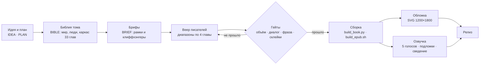

| Этап | Что делается | Чем проверяется |
|---|---|---|
| Фундамент | идея мира и раскадровка на 30 томов | у тома есть своя ставка, локация и двойной финал |
| Библия | канон: механика, люди, каркас 33 глав, таблица раскрытий | поздняя глава не «впервые находит» старое |
| Брифы | по абзацу на главу: 17–19 тыс. знаков, 3–6 сцен, клиффхэнгер через главу | рамки записаны до письма, а не после |
| Веер | главы диапазонами по 4 пишутся параллельно | диапазоны сплошные, файлов 34 |
| Гейты | объём, диалог, средняя фраза, тире, `…`, склейки, дубли | таблица порогов, а не «читается хорошо» |
| Сборка | единый текст и EPUB с обложкой | метрики в коридоре серии |
| Обложка | SVG руками, растр headless Chrome | кроп шапки и плашки смотрим глазами |
| Озвучка | 23 роли на два тембра, 4 подложки, 6 эффектов, сведение −20 LUFS | длительность против медианного темпа (10,8 зн/с), допуск 12 % |

Подробная механика каждого шага, пороги и команды — [PRODUCTION.md](PRODUCTION.md).

## Сборка

```bash
git clone https://github.com/rukazax/shov.git
cd shov

# текст: все главы в один файл + метрики в консоль
python3 BOOK01/build_book.py
python3 BOOK02/build_book.py

# машинные гейты тома 2 (объём, диалог, сцены, типографика, полнота)
BOOK02/gate.sh

# читательский дистрибутив: EPUB и единый markdown в dist/
BOOK01/build_epub.sh
BOOK02/build_epub.sh

# аудио: подложки и эффекты (один раз, ~2 минуты)
python3 audio/gen_beds.py

# аудио: одна глава или вся книга — кэш синтеза переиспользуется
python3 audio/render.py BOOK01/ch01.md
STREAMS=8 JOBS=3 ./audio/render_all.sh   # том 1, добьёт недостающие дорожки

# том 2 озвучивается тем же конвейером: BOOK=BOOK02
BOOK=BOOK02 STREAMS=8 JOBS=3 ./audio/render_all.sh
```

Проверка готовности озвучки: `python3 audio/check_out.py` — длительности, тишина по краям, громкость, битрейт.

## Структура

```
shov/
├── assets/
│   ├── banner.svg          баннер серии
│   ├── cover-tom1.png      обложка тома 1 (и .svg-исходник)
│   └── cover-tom2.png      обложка тома 2 (и .svg-исходник)
├── BOOK01/
│   ├── BIBLE.md            библия тома: люди, правила, каркас
│   ├── BRIEF.md            брифы глав 2–33
│   ├── ch00…ch33.md        главы
│   ├── SHOV-tom1.md        собранный текст
│   ├── build_book.py       сборка и статистика
│   └── build_epub.sh       EPUB для читалки
├── BOOK02/
│   ├── BIBLE.md            библия тома: мир, новые люди, каркас
│   ├── BRIEFS/chNN.md      брифы всех 33 глав
│   ├── ch00…ch33.md        главы
│   ├── SHOV-tom2.md        собранный текст
│   ├── build_book.py       сборка и статистика
│   ├── build_epub.sh       EPUB для читалки
│   └── gate.sh             машинные гейты тома
├── audio/
│   ├── gen_beds.py         подложки и эффекты
│   ├── render.py           озвучка и сведение
│   ├── render_all.sh      надзиратель: потоки по главам
│   ├── publish_when_done.sh приёмка, README, git
│   ├── eq_curve.json       кривая EQ под эталон 1С (правит eq_calibrate.py)
│   ├── VOICES.md           тембры, калибровка, подводные камни
│   ├── check_out.py        приёмка готовых дорожек
│   ├── TRACKS.md           дорожки тома 1 со ссылками на релиз
│   ├── TRACKS-2.md         дорожки тома 2 со ссылками на релиз
│   ├── cast/, cast-t2/     разметка ролей по блокам, том 1 и том 2
│   ├── out/, out-t2/       mp3 по главам (в git не входят)
├── IDEA.md                 идея серии: мир, механика, ставки
├── PRODUCTION.md           конвейер тома: этапы, пороги, команды
├── PLAN.md                 план на 30 томов
└── dist/                   EPUB и markdown для читателей (в git не входят)
```

## Права

Текст — © Константин Ерёмин. Скрипты сборки, озвучки и генерации подложек — MIT, берите и пользуйтесь: [LICENSE](LICENSE) распространяется на код репозитория, но не на сам текст и не на аудиодорожки — они остаются за автором, копировать и продавать их без разрешения нельзя. Голос серии снят с книг Михаила Атаманова как стилевой ориентир; ни одна строка из «Искажающих реальность» здесь не воспроизведена.

## English

<p align="center"><a href="https://github.com/rukazax/shov/releases/tag/v1.0"><b>⬇ Volume one</b></a> · <a href="https://github.com/rukazax/shov/releases/tag/v1.1"><b>🎧 Audiobook of volume one (34 tracks, 14 h 57 min)</b></a> · <a href="https://github.com/rukazax/shov/releases/tag/v2.0"><b>⬇ Volume two</b></a> · <a href="https://github.com/rukazax/shov/releases/tag/v3.0"><b>⬇ Volume three</b></a> · <a href="https://github.com/rukazax/shov/releases/tag/v4.0"><b>⬇ Volume four</b></a> · <a href="https://github.com/rukazax/shov/releases/tag/v5.0"><b>⬇ Volume five</b></a> · <a href="https://github.com/rukazax/shov/releases/tag/v6.0"><b>⬇ Volume six</b></a> · <a href="https://github.com/rukazax/shov/releases/tag/v7.0"><b>⬇ Volume seven</b></a> · <a href="https://github.com/rukazax/shov/releases/tag/v8.0"><b>⬇ Volume eight</b></a><br>EPUB · single-file markdown · cover artwork · audio in v1.1, 34 separate mp3 files</p>

**The Seam** — a thirty-volume series written in the voice of Mikhail Atamanov's *Distorting Reality* cycle, with a new world, new people and a new plot. Not a work by that author; the style profile was derived from thirteen volumes and stays out of this repository.

On 12 August 2019 a strip appeared in the sky over the Northern Urals: twelve kilometres long, a hundred and fifty metres wide. Not a portal, not a hole — a **seam between two realities with different geometry**. Alien geometry bleeds through it, and now and then people do too.

Beyond it lies the same Earth, where the seam opened two hundred and twenty years earlier. They built orbital elevators, fought two wars over the nodes and nearly killed themselves. Their 2029 is our 2029, and they would very much like to know where we have been for two centuries.

Semyon Loskutov, a lift repairman from Nizhny Tagil, climbs into an abandoned mine to fetch his grandmother's cat and falls through a leak. He comes back marked as a **conductor**: the lowest rank, one alignment a day, and a question nobody answers — what happens when the seam reaches the city.

| Volume 1 | Value |
|---|---|
| Title | *Splinter* (Щепка) |
| Chapters | 33 + Introduction |
| Length | 608 881 characters, 101 695 words |
| Scenes | 166 |
| Audiobook | 34 tracks, 14 h 57 min, 646 MB, five synthetic voices — [release v1.1](https://github.com/rukazax/shov/releases/tag/v1.1) |
| Formats | Markdown in repo, EPUB in Releases |

| Volume 2 | Value |
|---|---|
| Title | *Walker* (Ходок) |
| Chapters | 33 + Introduction |
| Length | 620 036 characters, 101 885 words |
| Scenes | 173 |
| Cast | the keeper of edge 4-bis (his own POV in the Introduction and chapter 18), sergeant Gushchin, surveyor Kovalyova, observer Somov |
| Audiobook | not rendered yet — the same pipeline, `BOOK=BOOK02 ./audio/render_all.sh` |
| Formats | Markdown in repo, EPUB in [release v2.0](https://github.com/rukazax/shov/releases/tag/v2.0) |

| Volume 3 | Value |
|---|---|
| Title | *Bridge* (Мост) |
| Chapters | 33 + Introduction |
| Length | 609,337 characters, 99,117 words, 15.2 author sheets |
| Scenes | 181 |
| System lines | 74 |
| Cast | a man in uniform from the far side who knows more about Semyon than Semyon does; Katts of the relocation office; smuggler Kerzhak; the second Semyon |
| Audiobook | not rendered yet — the same pipeline, `BOOK=BOOK03 ./audio/render_all.sh` |
| Formats | Markdown in repo, EPUB in [release v3.0](https://github.com/rukazax/shov/releases/tag/v3.0) |

| Volume 4 | Value |
|---|---|
| Title | *Support* (Опора) |
| Chapters | 33 + Introduction |
| Length | 600,431 characters, 97,166 words, 15.0 author sheets |
| Scenes | 149 |
| System lines | 162 |
| Cast | Skolkov, the last seam-keeper; seismologist Tkachuk; the second Semyon; the same city, now on a schedule |
| Audiobook | not rendered yet — the same pipeline, `BOOK=BOOK04 ./audio/render_all.sh` |
| Formats | Markdown in repo, EPUB in [release v4.0](https://github.com/rukazax/shov/releases/tag/v4.0) |

| Volume 5 | Value |
|---|---|
| Title | *Two Hundred Years* (Двести лет) |
| Chapters | 33 + Introduction |
| Length | 607,528 characters, 99,554 words, 15.2 author sheets |
| Scenes | 143 |
| System lines | 141 |
| Cast | the second Semyon, keeper of the door on the far side; Vera Pletnyova of the Svod archive; Tikhon Kozhin, the plumber who was made to weld the brace and could not |
| Audiobook | not rendered yet — the same pipeline, `BOOK=BOOK05 ./audio/render_all.sh` |
| Formats | Markdown in repo, EPUB in [release v5.0](https://github.com/rukazax/shov/releases/tag/v5.0) |

### Volume six «Alien Kin»

The stake of this volume is kin. By now the door neither opens nor closes: it works as mail. A work order, a pass, a window, a queue — and the first thing a visitor is handed on the far side is not a mark but a form.

The kinship bureau searches by surname, city and year, and finds more than was asked for. Semyon's grandmother is alive over there: the same Agraphena Prokopyevna, the same hands, only in a lane that does not exist on his side. The mother who walked out of his childhood here never left. The wife he remembers as his own has never met him.

Every kinship has a price, and the price is the same — home. Not "where you live" but "where you are listed": an entry, a column, a sheet. To acknowledge kin is to write yourself into someone else's book and out of your own. The other side's sheet holds harder than your own memory, and it asks for a signature.

How it ends: with the ninth sheet, a column headed "price", and a refusal to be entered.

| Parameter | Volume 6 | Series norm |
|---|---|---|
| Length | **610,541 characters** (15.3 author sheets) | 588–624 thousand |
| Without spaces | 496,087 characters | — |
| Chapters | 33 + Introduction | 26–37 |
| Average chapter | 18.3 thousand characters | 16–23 thousand |
| Words | 100,925 | — |
| Scenes | 139 (4 per chapter) | 3–6 per chapter |
| System lines | 68 | ~1 per 3.8 thousand characters |
| Cast | his grandmother, alive in a lane that does not exist on this side; his mother, who here never left; his wife, who has never met him; the kinship bureau and its forms |
| Dialogue | 50 % of lines | 30–38 % |
| Average sentence | 9.1 words | 12–16 |

Where the book leaves the norm, honestly:

- **more dialogue** (50 % against 30–38 %): the volume lives on conversations — the bureau, the bargaining, tea at his grandmother's; he learns his kin by talking, not by paperwork;
- **shorter average sentence** (9.1 against 12–16 words): the series cadence holds — a paragraph of reckoning, then one line as a blow; without it the voice is not the voice;
- **fewer system lines** (68 against ~160): paper pushed the system out here — a form, a sheet, a column. The registry gives the reference, not a game line.

Everything else is inside the corridor: length, chapter count, chapter size, scenes.

<details>
<summary>Volume 6 contents — 34 files, 610,541 characters</summary>

| # | Глава | Объём |
|---|---|---|
| 0 | Введение. Отказ Аграфены Прокопьевны | 7 тыс. |
| 1 | Глава первая. Почта | 19 тыс. |
| 2 | Глава вторая. Бюро | 19 тыс. |
| 3 | Глава третья. Первый отказ | 19 тыс. |
| 4 | Глава четвёртая. Цена приближения | 18 тыс. |
| 5 | Глава пятая. Заявление принято | 18 тыс. |
| 6 | Глава шестая. Торг | 18 тыс. |
| 7 | Глава седьмая. Сборы | 17 тыс. |
| 8 | Глава восьмая. Адрес, которого нет | 17 тыс. |
| 9 | Глава девятая. Переулок | 19 тыс. |
| 10 | Глава десятая. Первое окно | 19 тыс. |
| 11 | Глава одиннадцатая. Три дня отказов | 18 тыс. |
| 12 | Глава двенадцатая. Право на визит | 18 тыс. |
| 13 | Глава тринадцатая. Доказательства | 18 тыс. |
| 14 | Глава четырнадцатая. Валентина Петровна | 18 тыс. |
| 15 | Глава пятнадцатая. Разговор | 18 тыс. |
| 16 | Глава шестнадцатая. Она не уходила | 18 тыс. |
| 17 | Глава семнадцатая. Чай у бабушки | 19 тыс. |
| 18 | Глава восемнадцатая. Цена визита | 19 тыс. |
| 19 | Глава девятнадцатая. Теплосеть | 19 тыс. |
| 20 | Глава двадцатая. Аркадий Ткач | 18 тыс. |
| 21 | Глава двадцать первая. Отказ в родстве | 18 тыс. |
| 22 | Глава двадцать вторая. Список | 19 тыс. |
| 23 | Глава двадцать третья. Письмо | 18 тыс. |
| 24 | Глава двадцать четвёртая. Даша | 18 тыс. |
| 25 | Глава двадцать пятая. Бланк приписного | 18 тыс. |
| 26 | Глава двадцать шестая. Признание | 18 тыс. |
| 27 | Глава двадцать седьмая. Просьба | 19 тыс. |
| 28 | Глава двадцать восьмая. Две бабушки | 18 тыс. |
| 29 | Глава двадцать девятая. Письмо без веса | 19 тыс. |
| 30 | Глава тридцатая. Полоса | 19 тыс. |
| 31 | Глава тридцать первая. Отказ от приписки | 19 тыс. |
| 32 | Глава тридцать вторая. Графа «цена» | 19 тыс. |
| 33 | Глава тридцать третья. Девятый лист | 16 тыс. |

</details>

Read in full: [BOOK06/SHOV-tom6.md](BOOK06/SHOV-tom6.md) — a single file with a title page and an epigraph. EPUB is in [release v6.0](https://github.com/rukazax/shov/releases/tag/v6.0). The volume bible is [BOOK06/BIBLE.md](BOOK06/BIBLE.md), briefs are [BOOK06/BRIEFS](BOOK06/BRIEFS), the chapter spine is [BOOK06/SPINE.md](BOOK06/SPINE.md). The Russian text is the book itself; chapter titles are listed untranslated. Audio is not rendered yet — the same pipeline, `BOOK=BOOK06 ./audio/render_all.sh`.

### Volume seven «The Junction»

The stake of this volume is a signature. Semyon is no longer a guest or a walker: he has a clearance, a shift and a service called the Junction. The service has two factions, and both are right in their own way. "Order" treats the door as an object, and an object has a regulation and eleven hours to be closed. "People" count the names on the waiting list, and on the far side fourteen of them are standing behind the door.

After that the volume moves like an acceptance procedure: sheet, intake, protocol, act. Each document is honest on its own, and together they produce an order to close the door for eleven hours — exactly when fourteen people are on the other side. To sign is to agree that fourteen can wait. Not to sign is to lose the right to sign and the clearance itself, that is, the job he has become necessary for.

He does not sign. The service takes the signature, then the clearance; the factions swap places in their own rights, and the queue at the door gets fourteen names shorter, which is not a victory but paperwork.

How it ends: his daughter walks through the junction.

| Parameter | Volume 7 | Series norm |
|---|---|---|
| Length | **612,983 characters** (15.3 author sheets) | 588–624 thousand |
| Without spaces | 498,355 characters | — |
| Chapters | 33 + Introduction | 26–37 |
| Average chapter | 18.3 thousand characters | 16–23 thousand |
| Words | 100,145 | — |
| Scenes | 162 (5 per chapter) | 3–6 per chapter |
| System lines | 124 | ~1 per 3.8 thousand characters |
| Cast | the Junction service and its two factions, "order" and "people"; the waiting list; his daughter Dasha |
| Dialogue | 49 % of lines | 30–38 % |
| Average sentence | 8.7 words | 12–16 |

Where the book leaves the norm, honestly:

- **more dialogue** (49 % against 30–38 %): the service speaks in orders, protocols and intake forms, and the hero answers out loud, because a signature is never made in silence;
- **shorter average sentence** (8.7 against 12–16 words): the series cadence holds; the one-line blow is shorter than usual here.

System lines number 124 — one per 4.9 thousand characters, slightly rarer than the norm, because orders took their place. Everything else is inside the corridor: length, chapter count, chapter size, scenes.

<details>
<summary>Volume 7 contents — 34 files, 612,983 characters</summary>

| # | Chapter | Length |
|---|---|---|
| 0 | Введение. Одиннадцать часов | 8K |
| 1 | Глава первая. «Шаг» | 18K |
| 2 | Глава вторая. «Лицо» | 18K |
| 3 | Глава третья. «Перевод» | 18K |
| 4 | Глава четвёртая. «Присяга» | 18K |
| 5 | Глава пятая. «Лист» | 19K |
| 6 | Глава шестая. «Приёмка» | 18K |
| 7 | Глава седьмая. «Где ты живёшь» | 17K |
| 8 | Глава восьмая. «Журнал» | 18K |
| 9 | Глава девятая. «Будка» | 18K |
| 10 | Глава десятая. «Список Пожарской» | 18K |
| 11 | Глава одиннадцатая. «Цена часов» | 19K |
| 12 | Глава двенадцатая. «Лист ожидания» | 19K |
| 13 | Глава тринадцатая. «Сшились не туда» | 19K |
| 14 | Глава четырнадцатая. «Он не тот» | 18K |
| 15 | Глава пятнадцатая. «Кто платит» | 18K |
| 16 | Глава шестнадцатая. «Записки» | 18K |
| 17 | Глава семнадцатая. «Ночная смена» | 18K |
| 18 | Глава восемнадцатая. «Сколкова» | 19K |
| 19 | Глава девятнадцатая. «Приказ на закрытие» | 19K |
| 20 | Глава двадцатая. «Ночь перед» | 18K |
| 21 | Глава двадцать первая. «Протокол» | 19K |
| 22 | Глава двадцать вторая. «Его подпись» | 19K |
| 23 | Глава двадцать третья. «Отказ» | 18K |
| 24 | Глава двадцать четвёртая. «Голос за дверью» | 18K |
| 25 | Глава двадцать пятая. «Исполнение» | 19K |
| 26 | Глава двадцать шестая. «Право подписи» | 18K |
| 27 | Глава двадцать седьмая. «Разбор» | 18K |
| 28 | Глава двадцать восьмая. «Очередь стала короче» | 19K |
| 29 | Глава двадцать девятая. «Даша у стыка» | 18K |
| 30 | Глава тридцатая. «Наша бабушка» | 18K |
| 31 | Глава тридцать первая. «Восемь фигур» | 18K |
| 32 | Глава тридцать вторая. «Сорок седьмой лист» | 18K |
| 33 | Глава тридцать третья. «Порог» | 18K |

</details>

Read in full: [BOOK07/SHOV-tom7.md](BOOK07/SHOV-tom7.md) — a single file with a title page and an epigraph. EPUB is in [release v7.0](https://github.com/rukazax/shov/releases/tag/v7.0). The volume bible is [BOOK07/BIBLE.md](BOOK07/BIBLE.md), briefs are [BOOK07/BRIEFS](BOOK07/BRIEFS), the chapter spine is [BOOK07/SPINE.md](BOOK07/SPINE.md). Audio is not rendered yet — the same pipeline, `BOOK=BOOK07 ./audio/render_all.sh`.

### Volume eight «Orbit»

The stake of this volume is weight. Sideways he is no longer let through: the door does not take an inscribed man, the clearance is gone, and he lives on odd jobs and visits the junction the way other people visit a museum. Then what the service always knew becomes visible, the thing he never asked about: the seam has two exits. The second one goes up — in the same shaft where our cage descends, for water, theirs ascends, to the orbit of the Second Earth. Three hundred kilometres, six hours and forty minutes.

Lifts are rationed by weight, not kinship: the capsule takes four hundred and twenty kilograms, a man with a bag counts for two, and the queue moves once every three months. Out of turn they lift three people — a doctor, an inspector and a chaperone, whoever flies with a minor. Semyon takes another man's child as his grounds: Tim Somov, fourteen, forty-two kilograms, afraid of heights and not admitting it. For the first time he is not the victim of a form but its author.

Before the ascent there are fourteen days of quarantine, and quarantine is not about infection: it exists so a man has time to change his mind, and so the service has time to write down why he is flying. The journal has one column — "goal". The doctors do not believe it, but they write it.

Up there the seam opens into emptiness and does not grow: it is held from both sides. The upper junction is a station of four compartments, with its own inventory, its own sheet and its own ninth line, where his name stands before he writes it there. How it ends: the cage goes down without him, and over the comms he hears Dasha's voice — she is up here, but not where he was looking.

| Parameter | Volume 8 | Series norm |
|---|---|---|
| Length | **609,720 characters** (15.2 author sheets) | 588–624 thousand |
| Without spaces | 494,411 characters | — |
| Chapters | 33 + Introduction | 26–37 |
| Average chapter | 17.9 thousand characters | 16–23 thousand |
| Words | 100,251 | — |
| Scenes | 154 (4–5 per chapter) | 3–6 per chapter |
| System lines | 112 | ~1 per 3.8 thousand characters |
| Cast | Tim Somov, fourteen, his grounds; quarantine doctor Lida Korolyova and her "goal" journal; Grigory Tseitlin of the lift office; Vera Tyurina, keeper of the upper junction; the second Semyon, now a voice over the comms |
| Dialogue | 51 % of lines | 30–38 % |
| Average sentence | 8.7 words | 12–16 |

Where the book leaves the norm, honestly:

- **more dialogue** (51 % against 30–38 %): half the volume happens inside the capsule, where six people share one oxygen cylinder, and there is nothing to do there but talk;
- **shorter average sentence** (8.7 against 12–16 words): in quarantine and in the cage people answer briefly, because time is counted in hours there, not in paragraphs.

System lines number 112 — one per 5.4 thousand characters, rarer than the norm, because weight, plumb line and queue took their place. Everything else is inside the corridor: length, chapter count, chapter size, scenes.

<details>
<summary>Volume 8 contents — 34 files, 609,720 characters</summary>

| # | Chapter | Length |
|---|---|---|
| 0 | Введение. Четыреста двадцать | 7K |
| 1 | Глава первая. «Резерв» | 18K |
| 2 | Глава вторая. «Юля идёт сама» | 18K |
| 3 | Глава третья. «Ствол» | 19K |
| 4 | Глава четвёртая. «Сделка» | 18K |
| 5 | Глава пятая. «Очередь» | 19K |
| 6 | Глава шестая. «Карантинные сутки» | 19K |
| 7 | Глава седьмая. «Тим» | 18K |
| 8 | Глава восьмая. «Посадка» | 18K |
| 9 | Глава девятая. «Клеть» | 18K |
| 10 | Глава десятая. «Книга подъёма» | 18K |
| 11 | Глава одиннадцатая. «Остановка на минус двести» | 18K |
| 12 | Глава двенадцатая. «Что помнят» | 18K |
| 13 | Глава тринадцатая. «Высота» | 18K |
| 14 | Глава четырнадцатая. «Карантин до и после» | 19K |
| 15 | Глава пятнадцатая. «Зачем карантин» | 19K |
| 16 | Глава шестнадцатая. «Стыковка» | 19K |
| 17 | Глава семнадцатая. «Первый выход» | 18K |
| 18 | Глава восемнадцатая. «Четыре отсека» | 19K |
| 19 | Глава девятнадцатая. «Верхняя опись» | 19K |
| 20 | Глава двадцатая. «Работа на шве» | 18K |
| 21 | Глава двадцать первая. «Смена» | 18K |
| 22 | Глава двадцать вторая. «Семён-2» | 19K |
| 23 | Глава двадцать третья. «Акт» | 19K |
| 24 | Глава двадцать четвёртая. «Цена подписи» | 19K |
| 25 | Глава двадцать пятая. «Трос» | 18K |
| 26 | Глава двадцать шестая. «Смена, которую он берёт» | 18K |
| 27 | Глава двадцать седьмая. «Спуск» | 17K |
| 28 | Глава двадцать восьмая. «Сумка» | 18K |
| 29 | Глава двадцать девятая. «Журнал» | 18K |
| 30 | Глава тридцатая. «Правнучка» | 18K |
| 31 | Глава тридцать первая. «Юля по связи» | 18K |
| 32 | Глава тридцать вторая. «Девятая строка» | 17K |
| 33 | Глава тридцать третья. «Финал» | 18K |

</details>

Read in full: [BOOK08/SHOV-tom8.md](BOOK08/SHOV-tom8.md) — a single file with a title page and an epigraph. EPUB is in [release v8.0](https://github.com/rukazax/shov/releases/tag/v8.0). The volume bible is [BOOK08/BIBLE.md](BOOK08/BIBLE.md), briefs are [BOOK08/BRIEFS](BOOK08/BRIEFS), the chapter spine is [BOOK08/SPINE.md](BOOK08/SPINE.md). Audio is not rendered yet — the same pipeline, `BOOK=BOOK08 ./audio/render_all.sh`.

The full text is in Russian only: [BOOK01/SHOV-tom1.md](BOOK01/SHOV-tom1.md), [BOOK02/SHOV-tom2.md](BOOK02/SHOV-tom2.md), [BOOK03/SHOV-tom3.md](BOOK03/SHOV-tom3.md), [BOOK04/SHOV-tom4.md](BOOK04/SHOV-tom4.md), [BOOK05/SHOV-tom5.md](BOOK05/SHOV-tom5.md), [BOOK06/SHOV-tom6.md](BOOK06/SHOV-tom6.md), [BOOK07/SHOV-tom7.md](BOOK07/SHOV-tom7.md) and [BOOK08/SHOV-tom8.md](BOOK08/SHOV-tom8.md). Series plan, world rules and the style bible are in [PLAN.md](PLAN.md), [IDEA.md](IDEA.md) and [BOOK01/BIBLE.md](BOOK01/BIBLE.md) — also Russian.

The production pipeline — foundation, bible, briefs, fan-out, machine gates, assembly, cover, audiobook — is documented step by step in [PRODUCTION.md](PRODUCTION.md).

Everything is reproducible: `python3 BOOK01/build_book.py` assembles the book, `BOOK01/build_epub.sh` produces the EPUB, `STREAMS=8 JOBS=3 ./audio/render_all.sh` renders the audiobook chapter by chapter with caching.

**How the audiobook was made.** Five synthetic voices, four beds and six effects, all generated by code — nothing bought or downloaded. The narrator is `ru-RU-DmitryNeural`; the far side speaks with `en-US-BrianMultilingualNeural` and `en-AU-WilliamMultilingualNeural`; the female roles use `ru-RU-SvetlanaNeural`; the Alignment system lines are the narrator through ring modulation.

What actually hurt: the synthesis service drops about 30 % of requests in waves, so the renderer keeps a 25-second timeout, six retries and a block cache (a full chapter re-renders from cache in 20–25 s). The circuit breaker used to count *consecutive* failures and slept two minutes after ten seconds of work — it now watches silence since the last success. Speaker attribution had to be ordered strictly (name in the stage direction → speech verb → vocative → continuation) because the hero kept borrowing his grandmother's voice. The music bed is cut at 110 Hz, otherwise it hums in the pauses. The Windows synthesis box was being "restarted" on the wrong port, and the publisher died on a relative log path — both fixed in the scripts.

### Rights

The text is © Konstantin Eremin. The build, rendering and sound-bed scripts are MIT — take them and use them: [LICENSE](LICENSE) covers the source code of this repository, not the text itself and not the audio tracks, which stay with the author and may not be copied or sold without permission. The series voice is modelled on Mikhail Atamanov's books as a style reference; not a single line of «Искажающие реальность» is reproduced here.

`#audiobook #litrpg #series-plan #russian-prose #worldbuilding #tts`
