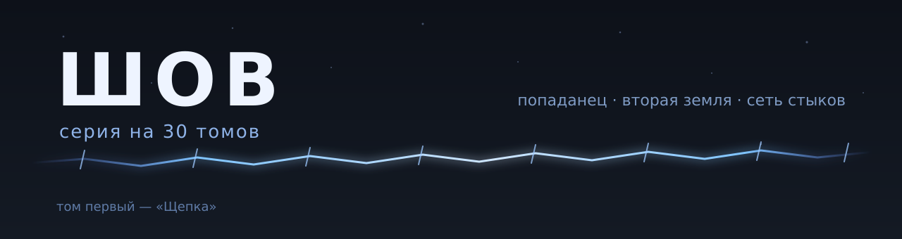

<p align="center"></p>

<h1 align="center">Голоса «Шова»</h1>
<p align="center">Как озвучка перестала звучать как робот — и что для этого сделано</p>

<p align="center">
  <b>RU</b> · <a href="#english">English</a>
</p>

<p align="center">
  
  
  
  
  
</p>

**Разделы:** [Как слушать](#как-слушать) · [С чего началось](#с-чего-началось) · [Что за движки](#что-за-движки) · [Что сделано](#что-сделано) · [Что дальше](#что-дальше) · [English](#english)

---

## Как слушать

Два файла, по 50 секунд: один и тот же диалог первой главы, заново синтезированный обоими движками. Четырнадцать реплик — описание, вопрос, восклицание, раздражение, крик, казённая речь начальника. Это и есть проверка: не «как звучит тембр», а «слышно ли, что человек живой».

| Движок | Образец | Длина | Громкость |
|---|---|---|---|
| XTTS v2 | [`tests/xtts_cast_demo.mp3`](tests/xtts_cast_demo.mp3) | 50,2 с | −20,5 LUFS |
| Chatterbox | [`tests/cb_cast_demo.mp3`](tests/cb_cast_demo.mp3) | 51,0 с | −19,7 LUFS |

| XTTS | Chatterbox | Что звучит | Что проверяем |
|---|---|---|---|
| 0:00 | 0:00 | «Утро началось с бабки и сломанного лифта» | ровное описание |
| 0:03 | 0:04 | бабка: «Ты его не рви, ты его гладь!» | восклицание |
| 0:06 | 0:06 | герой: «Я и глажу…» | вялая бытовая интонация |
| 0:09 | 0:09 | бабка: «Мне в поликлинику к девяти!» | раздражение |
| 0:12 | 0:12 | герой: «Успеете. Сейчас поднимем.» | успокаивающая |
| 0:15 | 0:16 | Михалыч: «По факту обращения граждан.» | второй мужской тембр |
| 0:19 | 0:19 | герой: «По какому факту?» | вопрос |
| 0:21 | 0:22 | Михалыч: «В рамках регламента мы обязаны.» | казённая речь |
| 0:25 | 0:26 | герой: «Там лифта нет! Там шахта!» | крик |
| 0:30 | 0:30 | Жарова: «Родственница ваша…» | другой женский тембр |
| 0:35 | 0:35 | герой: «На мяуканье?» | удивление |
| 0:36 | 0:37 | «Двенадцатого августа появилась полоса…» | длинная фраза описания |
| 0:45 | 0:45 | герой: «А до меня сюда кто-нибудь лазил?» | интерес |
| 0:47 | 0:48 | бабка: «Сеня, звони Вите!» | команда |

Голоса: рассказчик и герой — Римский (спокойный и напряжённый отрывки), бабка — Жильцова, второй женский — Жарова, начальник — Потеряев. У Chatterbox те же эталоны, но громкость эмоции задаётся ручкой `exaggeration`: 0,3 на описание, 0,55 на бытовые реплики, 0,9–0,95 на крик.

Оба файла сведены в моно, 48 кГц, 128 кбит/с, громкость выровнена по −20 LUFS — чтобы сравнивать голоса, а не громкость. Пауз длиннее секунды внутри нет: проверено `silencedetect`.

## С чего началось

Текущая озвучка тома сделана на `edge-tts`: семнадцать ролей, тридцать четыре дорожки, подложка, эффекты. Для черновика — отлично. Для «как у 1С-Паблишинг» — нет: голоса читают ровно, эмоции в них ровно ноль, и это слышно с первой фразы.

Вот только брать готовые записи 1С нельзя — и не по жадности, а по закону. Зато можно снять с них **мерки**: темп, громкость, тембр. Что и сделано: из записей Влада Римского, Жильцовой, Чирковой и Потеряева вырезаны десятисекундные эталоны.

Сами эталоны в репозиторий не выложены — это чужие записи. Лежат локально, служат образцом для клонирования голоса и для замеров.

| Эталон | Длина | Громкость |
|---|---|---|
| Римский, спокойно | 12,5 с | −23,1 LUFS |
| Римский, напряжение | 10,5 с | −22,8 LUFS |
| Жильцова | 10,6 с | −20,1 LUFS |
| Чиркова | 11,5 с | −20,0 LUFS |
| Потеряев | 11,5 с | −20,3 LUFS |

Неприятная деталь, которую видно уже на мерках: темп наследуется от эталона. Нарезал отрывок побыстрее — и все реплики поехали быстрее. Поэтому эталон надо подбирать не только по тембру, но и по скорости.

## Что за движки

Шёл по списку кандидатов и отбрасывал по железу и по доступности весов.

| Кандидат | Что это на самом деле | Влезает в 8 ГБ | Вердикт |
|---|---|---|---|
| «moe» → Fish Audio Drama 3 | 35B mixture-of-experts, 70 ГБ весов | нет | отказ: не наше железо |
| «strata» → Stra / stra.ai | облачный клон по 30 с, весов нет | — | отказ: чёрный ящик и платно на 34 главы |
| ZONOS2 (Zyphra) | настоящий MoE, русский есть, GGUF q8 = 8,5 ГБ | q4 — да | отложен: третий заход |
| **XTTS v2** (Coqui) | клон по 10–12 с, 6 ГБ VRAM | да | взят |
| **Chatterbox Multilingual** | 23 языка, ручка «эмоция», 6 ГБ VRAM | да | взят |

Аббревиатуру «moe» я понял как mixture-of-experts: модели с таким именем не нашлось. Если имелось в виду что-то другое — скажи, проверю именно это.

Почему два, а не один. XTTS точнее держит тембр эталона, но эмоцию приходится добывать подбором отрывка: спокойный и напряжённый Римский — это два разных эталона. Chatterbox умеет эмоцию **ручкой** `exaggeration`, зато тембр держит чуть вольнее. Для книги, где герой то шутит, то орёт, вторая ручка важнее.

## Что сделано

Железо: Windows-машина рядом, RTX 2080 Max-Q на 8 ГБ, Python 3.10, `torch 2.5.1+cu124`, CUDA поднялась.

Два сервера, а не один — вот этот момент стоил вечера:

```
:8765  XTTS v2                 numpy 2.x
:8766  Chatterbox Multilingual  numpy < 2
```

Совместить в одном окружении нельзя: Chatterbox требует старый numpy, XTTS — новый. Поэтому два venv и два HTTP-сервера, оба принимают JSON и отдают wav. Веса Chatterbox (3 ГБ) тянул BITS с докачкой — сеть рвалась, размер сошёлся байт в байт.

Замеры и калибровка:

- кривая тембра под эталон 1С посчитана и лежит в [`eq_curve.json`](eq_curve.json) — пятнадцать точек от 55 Гц до 12 кГц;
- громкость всех образцов выровнена `loudnorm` до −20 LUFS, пик −2 dBTP;
- длительность, тишина и битрейт каждого файла проверены `ffprobe` и `silencedetect`, а не «на слух».

Одна неприятность, которую стоит записать. XTTS иногда зацикливается: короткая фраза с восклицанием вдруг растягивается на двадцать секунд и повторяет себя. Зависит не от текста, а от дубля — тот же запрос в следующий раз отвечает нормально. Лечение простое: синтез в три попытки, берётся самый короткий дубль, а всё, что длиннее расчётного темпа в полтора раза, отбрасывается как брак.

Chatterbox так не делает — но у него своя беда: он медленнее в разы, минута диалога считается несколько минут.

Чего я не могу: слышать. Громкость, длину и паузы я меряю, «живой голос или синтез» — решает человек. Поэтому образцы и выложены: слушай и выбирай.

## Что дальше

1. Выбрать движок и тембры — за тобой.
2. Разложить семнадцать ролей по выбранным эталонам.
3. Прогнать целую главу, а не абзац: на десяти минутах слышно то, чего не слышно на десяти секундах.
4. Применить кривую тембра и сравнить с эталоном по полосам.

Выбор владельца фиксируется здесь, в таблице настроек, — как только он будет.

---

## English

<p align="center"><b>RU</b> · <a href="#голоса-шова">Наверх</a></p>

### How to listen

Two files, 50 seconds each: the same chapter-one dialogue, synthesized from scratch by both engines. Fourteen lines — narration, a question, an exclamation, irritation, a shout, a clerk's canned speech. That is the test: not "how does the timbre sound", but "can you hear a living person".

| Engine | Sample | Length | Loudness |
|---|---|---|---|
| XTTS v2 | [`tests/xtts_cast_demo.mp3`](tests/xtts_cast_demo.mp3) | 50.2 s | −20.5 LUFS |
| Chatterbox | [`tests/cb_cast_demo.mp3`](tests/cb_cast_demo.mp3) | 51.0 s | −19.7 LUFS |

| XTTS | Chatterbox | Line | What it tests |
|---|---|---|---|
| 0:00 | 0:00 | "The morning started with grandma and a broken lift" | even narration |
| 0:03 | 0:04 | grandma: "Don't yank it, stroke it!" | exclamation |
| 0:06 | 0:06 | hero: "I am stroking it…" | weary everyday tone |
| 0:09 | 0:09 | grandma: "I have a clinic appointment at nine!" | irritation |
| 0:12 | 0:12 | hero: "You'll make it. We'll get it up." | reassuring |
| 0:15 | 0:16 | Mikhaylych: "Per the citizen's request." | second male timbre |
| 0:19 | 0:19 | hero: "Per which request?" | question |
| 0:21 | 0:22 | Mikhaylych: "The regulations oblige us." | bureaucratic |
| 0:25 | 0:26 | hero: "There is no lift! It's a shaft!" | shout |
| 0:30 | 0:30 | Zharova: "Your relative, if I'm not mistaken." | second female timbre |
| 0:35 | 0:35 | hero: "At a meow?" | surprise |
| 0:36 | 0:37 | "On 12 August a stripe appeared…" | long descriptive sentence |
| 0:45 | 0:45 | hero: "Has anyone been down there before me?" | curiosity |
| 0:47 | 0:48 | grandma: "Seryozha, call Vitya!" | command |

Voices: narrator and hero — Rimsky (calm and tense clips), grandma — Zhiltsova, second female — Zharova, the boss — Poteryaev. Chatterbox uses the same references, with emotion set by the `exaggeration` knob: 0.3 for narration, 0.55 for everyday lines, 0.9–0.95 for the shout.

Both files are mono, 48 kHz, 128 kbps, normalized to −20 LUFS, so you compare voices rather than loudness. No silence gap over one second inside: checked with `silencedetect`.

### Where it started

The chapter render runs on `edge-tts`: seventeen roles, thirty-four tracks, ambient beds, effects. Fine for a draft, useless for "sounds like 1C-Publishing": the voices read evenly, with zero emotion, and you hear it in the first sentence.

Copying the 1C recordings is not an option — legally. Measuring them is: tempo, loudness and timbre were taken from Rimsky, Zhiltsova, Chirkova and Poteryaev as ten-second reference clips. The clips stay local; foreign recordings are not committed.

One catch visible in the measurements: tempo is inherited from the reference. Pick a faster clip and every line speeds up. So a reference must match both timbre and pace.

### The engines

| Candidate | What it really is | Fits 8 GB | Verdict |
|---|---|---|---|
| "moe" → Fish Audio Drama 3 | 35B mixture-of-experts, 70 GB of weights | no | rejected: wrong hardware |
| "strata" → Stra / stra.ai | cloud clone from 30 s, no weights | — | rejected: black box, paid per chapter |
| ZONOS2 (Zyphra) | real MoE, Russian supported, GGUF q8 = 8.5 GB | q4 only | deferred |
| **XTTS v2** (Coqui) | zero-shot clone from 10–12 s, 6 GB VRAM | yes | chosen |
| **Chatterbox Multilingual** | 23 languages, emotion knob, 6 GB VRAM | yes | chosen |

Why two. XTTS holds the reference timbre more faithfully, but emotion has to come from picking the right clip — calm and tense Rimsky are two different references. Chatterbox has emotion as a **knob** (`exaggeration`) and holds timbre a bit looser. For a hero who jokes in one paragraph and shouts in the next, the knob matters more.

### What was built

A Windows box next door: RTX 2080 Max-Q (8 GB), Python 3.10, `torch 2.5.1+cu124`, CUDA up.

Two servers instead of one — this cost an evening:

```
:8765  XTTS v2                 numpy 2.x
:8766  Chatterbox Multilingual  numpy < 2
```

Chatterbox requires the old numpy, XTTS the new one; a single environment cannot hold both. So two venvs and two HTTP servers, each taking JSON and returning wav. The 3 GB of Chatterbox weights were pulled with BITS resume — the network kept dropping, the size matched byte for byte.

Calibration and checks:

- a timbre curve against the 1C reference is computed and stored in [`eq_curve.json`](eq_curve.json) — fifteen points from 55 Hz to 12 kHz;
- every sample is normalized with `loudnorm` to −20 LUFS, −2 dBTP peak;
- length, silence and bitrate of each file are verified with `ffprobe` and `silencedetect`, not by ear.

One nuisance worth recording. XTTS sometimes loops: a short exclamation suddenly stretches to twenty seconds and repeats itself. It depends on the take, not the text — the same request answers fine next time. The fix is simple: synthesize three takes, keep the shortest, discard anything longer than 1.5 times the expected pace as defective.

Chatterbox doesn't loop — but it is several times slower: a minute of dialogue takes minutes to compute.

What I cannot do: hear. Loudness, length and pauses I measure; whether it sounds alive is a human call. That is exactly why the samples are published.

### Next

1. Pick the engine and timbres — your call.
2. Map seventeen roles onto the chosen references.
3. Render a whole chapter, not a paragraph: ten minutes reveal what ten seconds hide.
4. Apply the timbre curve and compare against the reference band by band.

The owner's choice gets recorded here, in the settings table, as soon as it exists.

---

`#tts #xtts #chatterbox #audiobook #russian #local-ai #coqui #voice-cloning`
